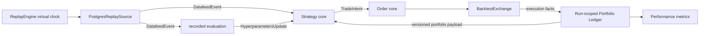

# Backtest

[中文](backtest_CN.md) · [Architecture overview](../../overview.md)

**Status:** Implemented deterministic replay and simulated-execution component;
realistic depth, partial-liquidity, and latency modelling remain bounded gaps.

`SigbotBacktestServer` evaluates historical economic behavior by composing the
same feed, evaluation, deterministic strategy, order, exchange, and portfolio
contracts used by live trading with run-scoped simulation adapters. It is not a
duplicate Datafeed service, a duplicate exchange microservice, or an E2E test.

## Run-scoped Composition

One isolated run-scoped replay runtime owns virtual time, input range, Workflow and
artifact versions, deterministic seed, evaluator mode, simulation policy,
event journal, run database/namespace, checkpoints, result, and cancellation
state. Parallel runs share no mutable strategy or portfolio state.

## Simulation Adapters

| Capability    | Live implementation                             | Backtest implementation                                    |
| ------------- | ----------------------------------------------- | ---------------------------------------------------------- |
| Market source | `IDatafeed` through the live Datafeed component | `PostgresReplaySource` reading canonical archived events   |
| Clock         | Wall clock at the live service boundary         | Virtual clock owned by `ReplayEngine`                      |
| Venue         | Provider `IExchange`                            | `BacktestExchange`                                         |
| Portfolio     | Wallet service                                  | Run-scoped implementation of the same accounting contracts |
| Transport     | Local or MQTT Messager                          | Isolated local event bus by default                        |

The replay source reads normalized kline, trade, order-book, funding, and
approved news events. It does not reconnect to live Binance/Twitter providers;
testing ingestion adapters and real middleware is E2E scope.

The Backtest matching venue—not an “Exchanger”—owns the currently implemented
venue behavior: market execution, resting limit crossing on later ticks,
configured slippage and fees, acknowledgements, and deterministic execution
facts. Accounting effects are applied by the run-scoped portfolio ledger rather
than duplicated inside the exchange simulator. Stop orders, partial liquidity,
latency, funding, margin, cancellation races, and forced liquidation remain
explicit model gaps.

## Evaluator Replay Policy

| Policy          | Evaluation behavior                                            | Current status                                   | Reproducibility            |
| --------------- | -------------------------------------------------------------- | ------------------------------------------------ | -------------------------- |
| Fixed fixture   | Replay one recorded, versioned `HyperparametersUpdate` fixture | Supported through recorded artifacts             | Deterministic              |
| Recorded stream | Replay recorded updates at original publication/effective time | Implemented default                              | Deterministic              |
| Recompute       | Run Evaluator only against virtual-time-visible data           | Reserved enhancement; no runtime mode exists yet | Would be non-deterministic |

Because the production strategy depends on evaluation, the default cannot
silently omit it. The implemented recorded-stream path preserves historical AI
advice while reproducing strategy, risk, and execution logic. A future
recompute path must record model/provider, model version, prompt/tool versions,
temperature, seed when available, and the complete evaluation artifact; its
results must be reported as a distribution rather than one deterministic score.

## Event Time and Look-ahead Safety

- Events are ordered by source event time with a deterministic tie-breaker.
- An evaluation is visible only at or after its original `published_at` and
  `valid_from`; its input watermark cannot exceed the strategy decision event.
- A portfolio snapshot is visible only after the matching transaction that
  produced it commits.
- Any future recompute mode must receive the virtual clock and must not access
  current live market data.
- Gaps, corrections, delistings, corporate actions, and funding schedules are
  explicit dataset events, not silently repaired with future data.

## Extension Points

| Role            | Contract                         | Implementation                                 |
| --------------- | -------------------------------- | ---------------------------------------------- |
| Service root    | `SigbotBacktestServer`           | Component startup and Provider registration    |
| Engine          | `ReplayEngine`                   | Virtual-time delivery and barrier coordination |
| Replay ports    | `ReplaySource`, `ReplayDecision` | Historical input and decision delivery         |
| Historical feed | `PostgresReplaySource`           | Keyset reads of canonical persisted events     |
| Backtest venue  | `IExchange`                      | `BacktestExchange`                             |

## Results and Invariants

The implemented durable result surface is the frozen input identity, replay
cursor/checkpoint, virtual clock, simulated order/execution facts, Outbox, and
Wallet accounting state. Equity curves, drawdown/risk-adjusted summaries,
turnover, and win/loss analytics must be derived by a reporting layer; the
Backtest component does not yet persist a complete performance-report model.

- Rerunning a fixed fixture or recorded stream with identical artifacts and engine version
  yields byte-equivalent decisions and accounting results.
- No simulation event can mutate live Order or Wallet stores or use live
  trading credentials.
- Checkpoints are consistent at event boundaries. A complete user-facing
  cancellation/result state machine remains an enhancement.
- Execution and accounting use decimal arithmetic and the same validation
  contracts as live mode.
- Backtest measures strategy economics; E2E tests process boundaries, broker,
  databases, deployment, and adapter integration. One does not substitute for
  the other.

## Implementation Alignment

`SigbotBacktestServer` now composes persisted history, a virtual clock, replay
barriers, recorded evaluation output, the normal Strategy callbacks, and the
dedicated simulated execution adapter. Resting limit orders are matched by
subsequent persisted ticks with deterministic ordering, configured fees and
slippage; execution and Outbox commit together. Repeated or late input and a
process restart do not create a second fill.

The simulator deliberately does not claim order-book queue priority, partial
available liquidity, venue network latency, or every distributed model-shard
equivalence. Those are enhancements, not hidden behavior of the current full-
fill model.

## Frozen matching state

`bt_order` durably stores the original message, matching owner, InstrumentSpec, fees and slippage policy. A late tick with event time before order acceptance cannot fill the order; duplicate ticks and restart cannot create another execution. Slippage rounds adversely to the instrument price tick. Old orders without a matching owner or frozen terms require explicit reconciliation, never guessed migration. Multiple independent query owners returning at the same virtual instant require additional deterministic scheduling; current guarantees do not establish global model-shard equivalence.

## Source Map

- Backtest component: `src/component/backtest/`
- Backtest repositories: `src/core/src/modules/backtest/storage/`
- Strategy execution: `src/component/strategy/`
- Exchange contracts: `src/exchange/`
- Wallet accounting contracts: `src/component/wallet/`
