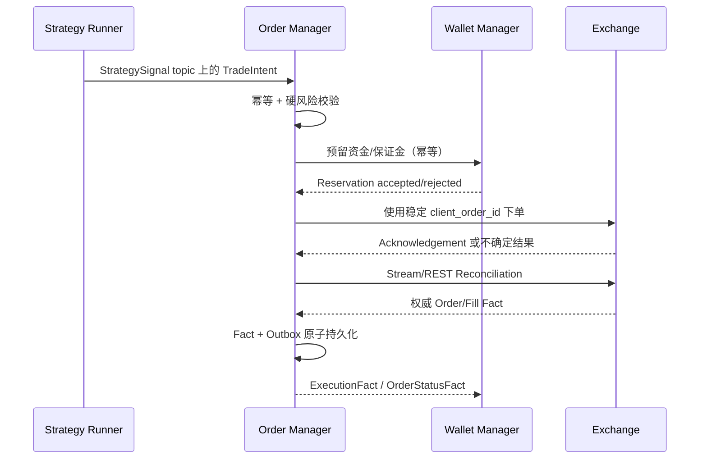

# Order Manager

[English](order.md) · [架构总览](../../overview_CN.md)

**状态：** 已实现预占先行的执行与对账链路；实盘资金和真实跨所验收仍是外部缺口。

`SigbotOrderServer` 是唯一允许调用 Exchange 私有交易能力的服务。它消费可执行
`TradeIntent`，执行权威 Risk/Account 校验，拥有 Order/Fill 状态机，对账交易所
不确定结果，并发布不可变 Execution Fact。

## 执行流程



Placement Acknowledgement 不是 Fill。发生未知 Timeout 时，必须先按稳定 Client Order
ID 对账，才能重试，避免创建重复外部订单。永久 Validation/Rejection Error 不能盲目
Retry。

## 所有状态与事件

`ord_*` 表领域只有 Order Repository 一个写入方，保存：

- 已接受 Strategy Intent 与 Idempotency Key；
- Order 及其合法 State Transition；
- Execution Attempt 与外部 Request/Response Reference；
- 从 Venue 得到的不可变 Fill、Fee、Funding、Settlement、Cancellation、Rejection 与
  Liquidation Fact；
- Reconciliation Cursor 与 Transactional Outbox Entry。

持久 Execution 消息保留 Envelope scope、源节点、Run、序列以及 Account、Wallet、
Venue、Client/Exchange Order、Trade、Instrument、Price、Quantity、Fee 和事件时间。
Order Receipt/Status 与改变资金的 `ExecutionFact` 是不同契约。

Wallet 只消费权威资金事实；Exporter 可以消费完整且已批准的 Execution Stream；
Notifier 接收类型化 Operational Event，而不是原始 Exchange Payload。

## 扩展点

| 角色         | 契约                    | 示例                                               |
| ------------ | ----------------------- | -------------------------------------------------- |
| Service Root | `SigbotOrderServer`     | 组件启动与 Provider 注册                           |
| Order Policy | `IOrder`                | `WorkflowOrderProcessor`                           |
| 硬风险       | `RiskPolicy`            | Account、Position、Exposure、Price 与 Rate Policy  |
| Venue Access | `IExchange`             | 感知 Capability 的 Venue Adapter                   |
| Persistence  | Core Handler/Repository | `OrderPostgresRepository`、`OrderSQLiteRepository` |

`RiskPolicy` 是可独立测试的组件，但最终 Allow/Deny 由 Order 拥有，
Strategy 建议不能绕过。

## 一致性边界

- 接受 Intent、推进本地 Order State、写 Outbox 属于同一 Transition 时，必须在一个
  Order Transaction 中完成。
- Wallet 资金/保证金 Reservation 使用幂等 Service Contract，不授予 Order 访问
  Wallet Table 的权限。
- 当前最终态迁移把 `ord_*` 与 `wlt_*` 放在同一个物理 Schema，但两者的 Core
  Repository 与写所有权必须独立。
- 跨服务通过 Outbox/Inbox、Retry、Replay 与 Exchange Reconciliation 达成可恢复、
  可审计一致性。
- 如果 Order 与 Portfolio Accounting 必须在一个本地 ACID Transaction 内，则应
  成为一个物理 Bounded Context；禁止两个 daemon 通过共享可写表走捷径。

## 安全不变量

- 任何外部副作用发生前，必须按持久 scope、producer node、`run_id` 与 seq 去重。
- 每个 Placement Attempt 使用 Venue 支持的稳定 Client Order ID。
- 同一 Order/Account 的冲突 Transition 串行化，无关工作可以并发。
- 下单前立即校验 Instrument Rule、Price/Quantity Precision、Account Permission、
  可用 Reservation、Exposure 与 Stale-market Guard。
- Exchange Network Call 期间禁止持有数据库 Lock 或 Transaction。
- Credential 留在 Exchange Adapter 安全边界内，禁止进入 Intent 或 Execution Event。

## 实现对齐

`SigbotOrderServer` 已校验作用域 Intent、持久行情证据、余额/仓位、Instrument 精度、
执行模式和硬风控，再请求 Wallet 预占。Live Submission 先持久准备；Placement ACK 与
Fill 分离；未知结果保留并进入 Venue 对账；Order/Execution Observation 与 Outbox 同事务
提交。Execution Group 等待权威 Leg 与 Wallet 结果后，再通过同一路径发出 reduce-only 补偿。

现有验收覆盖 Paper/Backtest 和 SDK/RPC 边界夹具，不代表实盘结算、全交易所撤单竞态
或真实跨所补偿。

<a id="exchange-sdk"></a>

## 内嵌 Exchange SDK

Exchange 不是独立 daemon，而是 Capability-based Async SDK：Datafeed 组合公共市场
Stream，Order Manager 组合私有交易，Wallet Manager 用于账户对账，Backtest 组合
模拟执行。Provider 细节不能泄漏到固定 Pipeline Contract。

### Capability 模型

`IExchange` 标识 Venue/Account Adapter。当前实际导出的 Capability Port 是：

| Port                   | 职责                                           |
| ---------------------- | ---------------------------------------------- |
| `IOrderBookExchange`   | Venue 的价格、Kline 与 Order Book 读取         |
| `IStockExchange`       | 股票订单提交和查询                             |
| `IExecutionAdapter`    | 持久 prepare、submit、reconcile 与执行事实读取 |
| `IPublicMarketAdapter` | 只读的规范化公共行情快照                       |

Spot、Margin、Perpetual/Futures、Option、Equity 与 Prediction Market 分别声明 Capability
与 Product Metadata。不支持的操作返回类型化 Capability Error，禁止 Panic 或静默
映射到另一 Market Type。

### Adapter 结构

```text
IExchange
  -> SigbotBinanceExchangeClient
       -> Spot capabilities
       -> USD-M futures capabilities
  -> SigbotHyperliquidExchangeClient
  -> SigbotIbkrExchangeClient
  -> SigbotPolymarketExchangeClient
  -> SigbotKalshiExchangeClient
  -> PaperExchange
  -> BacktestExchange
```

以上是当前实际 Adapter 目录。Capability 完整度不同：当前只有显式接入执行工厂的
Binance、IBKR、Polymarket 进入已验收 Live 下单路径；其他 Adapter 对不支持的能力必须
返回类型化错误，不能 panic 或静默改路由。

### 规范化

Adapter 把 Provider-specific Instrument、Order Type、Status、Precision、Error Code、
Timestamp、Sequence 与 Fill 映射成版本化 SigBot 类型。原始 Payload 可以作为脱敏
Diagnostic Extension 保留，但不能成为业务契约。

Instrument Metadata 拥有 Tick Size、Lot Size、Minimum Notional、Currency、Contract
Multiplier、Margin Mode 与支持的 Order Feature。Price、Quantity、Fee、Balance 全部
使用显式 Decimal 语义。

### Order 与 Stream 语义

- Order Manager 提供稳定 `client_order_id`；Retry 前先按该 ID 对账。
- Placement Acknowledgement、Order State、Trade Fill、Settlement、Fee、Funding 与
  Liquidation 是不同事实。
- 低延迟 Fact 优先来自 Private WebSocket；REST Query 用于 Reconcile Gap、Reconnect
  与不确定结果。
- Stream Event 暴露 Provider Sequence/Cursor 与 Connection Generation，使 Consumer
  能识别 Duplicate、Gap 与 Out-of-order Delivery。
- Rate Limit 按 Provider/Account Credential Scope 共享，不能由每条 Request Path 各自
  重建。

### 安全与可靠性不变量

- Credential 在 Adapter 内部从 Secret Reference 解析，禁止通过公共配置或 Event 返回。
- Signing 严格使用 Provider Timestamp/Nonce Policy 与有界 Clock Offset；Sensitive
  Request/Response Field 必须脱敏。
- Timeout 在 Reconciliation 证明成功或失败前分类为 Unknown Outcome。
- Retry Policy 区分 Safe Read、Idempotent Write 与 Non-idempotent External Side Effect。
- Sandbox/Testnet 与 Production Endpoint 不能误共用 Account ID 或 Credential Object。
- WebSocket Reconnect 必须先恢复 Subscription 与 Gap，再宣告 Stream Healthy。

### 实现对齐

真实订单入口由 `ExchangeFactory` 和 `ExecutionAdapterConfig` 按配置选择 Binance
Spot 官方 SDK、IBKR `ibapi` TWS/Gateway SDK 或 Polymarket 官方 V2/V3 SDK。Backtest
选择专用历史执行接口，禁止改写 Live 交易所 URL。旧市场数据 Source 接口仍按原目录
保留；它们不作为这些真实订单的执行路径。

Binance 使用业务键的稳定编码作为 client order ID，关闭 SDK 写入重试。
IBKR 和 Polymarket 先 `prepare`，随后 Order 仓库在 Wallet 预占成功后持久化
`PreparedSubmission`，最后单次领取提交权。IBKR 保存 SDK order ID、Contract、Order；
Polymarket 保存官方 Solidity ABI 编码、签名与 EIP-712 order hash。重启只读取已保存
负载并对账，不能重新分配 ID、salt 或签名后盲目提交。

准备负载用 OpenSSL AES-256-GCM 加密，AAD 绑定租户、环境、账户、Workflow、
节点、run/seq、交易意图及交易所订单 ID。`prepared_keys.active_key` 选择密钥版本，
`prepared_keys.keys` 映射版本到中央 Secret map key（值为 32 字节十六进制密钥）。轮换时
保留尚有未终结订单的旧密钥。密钥和交易凭据均不进入策略进程。

IBKR 配置显式网关地址、独占 `client_id`、账户 Secret key 引用及 SDK Contract 映射，要求
Contract 已有确定的 `contract_id`；每次新连接检查账户归属，禁 SDK 自动重连重发。
其 SDK 的 f64 边界进行 Decimal 往返校验，不能精确保留的数量或价格直接拒绝。
Polymarket 限价使用 GTC；市价意图使用 FOK、固定股数以及风控市场证据中的价格上限/
下限，禁止突破预占现金预算。Polymarket `matched` 只表示撮合受理，不能当链上结算。

Order 轮询适配器的真实成交事实，在同一事务中保存交易所游标、去重记录与 MQTT
Outbox。Binance 使用官方 `myTrades` 的实际成交现金与佣金；IBKR 按执行 ID 连接
官方成交及佣金报告，仅支持股票/ETF。缺少佣金或收到成交更正时必须对账，不填零费率。

Polymarket 必须配置 `settlement: {rpc_url_secret: polygon_rpc_url, min_confirmations: 64}`；
中央 Secret map 项保存 HTTPS Polygon RPC 地址，缺少配置时工厂拒绝启动。下单之前验证链 137、
官方交易所合约、抵押币精度及 finalized 区块读取能力，并将起始区块一同密封持久化。
恢复后按已保存订单哈希分页扫描有界区块范围，每页最多处理 32 条回执，使大订单可
在 RPC 超时内持续推进游标。逐条验证回执成功、区块仍在主链且已
finalized、确认深度达标，以及 maker/token/side/exchange 与订单完全一致。
品种配置使用 `base_asset: outcome:<token_id>`、`quote_asset: pUSD`。
旧 prepared order 没有扫描边界时必须人工对账，不能自动重下。

实际抵押币成交额及手续费直接读取官方
[OrderFilled ABI](https://github.com/Polymarket/ctf-exchange-v2/blob/ccc0596074f4dfd62c944fbca4de252893b82b4b/src/exchange/interfaces/ITrading.sol)
及[抵押币费用定义](https://github.com/Polymarket/ctf-exchange-v2/blob/ccc0596074f4dfd62c944fbca4de252893b82b4b/src/exchange/mixins/Fees.sol)。
`ExecutionFact.quote_quantity` 保留实际现金额，单位价出现无限小数时也不重新相乘
计算入账金额；旧事实缺少该字段时保持原计算兼容。链上成交自然 ID 是交易哈希和
日志序号。Wallet 等对应真实成交及费用到齐后才根据终态释放预占。

结算测试明确使用合成的外部 RPC 回执样本，验证解码、精确金额、回滚/未确认/身份
不符的拒绝；真实 Alloy HTTP 客户端连接本地 Axum 样本服务，验证预检、分页、重投
保持同一成交事实及拒绝错误链。它们及离线 SDK、数据库测试均不代表已执行实盘成交；
测试不发送真实订单。

### 源码地图

- Exchange SDK 与 Provider Adapter：`src/exchange/`
- 共享 Exchange 类型：`src/types/src/exchange/`

## 源码地图

- Order 数据面组件：`src/component/order/`
- Order Repository：`src/core/src/modules/order/storage/`
- Exchange Client：`src/exchange/`
- Order 与 Trade Event 类型：`src/types/src/order/`
