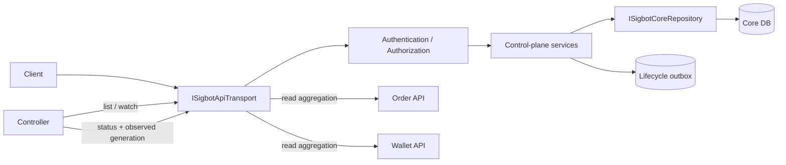

# APIServer

[中文](overview_ZH.md) · [Architecture overview](../../overview.md)

**Status:** Normative target architecture with current implementation gaps.

`SigbotApiServer` is SigBot's control-plane boundary. Like the Kubernetes API
Server, it is the only component allowed to read or write the core persistent
database. Every controller or engine obtains desired state through versioned
APIs, watches, immutable configuration snapshots, or events.

## Responsibilities

- Authenticate principals and apply the policy contract owned by
  [Tenant Governance & IAM](tenant-governance-and-iam.md).
- Validate, default, version, and persist control-plane resources, including
  tenant configuration and fixed `StrategyPipeline` specifications.
- Provide CRUD, list, watch, optimistic-concurrency, status, and audit APIs.
- Publish lifecycle events only after the corresponding persistent change is
  committed, using a transactional outbox where events are required.
- Aggregate Order and Wallet read APIs for clients when a unified public API is
  useful; aggregation never grants access to their private databases.
- Generate OpenAPI from registered routes and keep authentication, validation,
  pagination, and error envelopes consistent.

It does not deploy workloads, ingest market data, run AI or Python strategy
code, place orders, or update portfolio ledgers.

## Control-plane Contract

Every mutable resource has a stable ID, tenant and optional namespace scope,
spec generation, resource version, audit metadata, and status subresource.
Status writers cannot mutate desired-state fields. Watch consumers resume from
a resource version and recover with a full list after compaction or gaps.

## Extension Points

| Role | Contract | Examples |
|---|---|---|
| Service root | `SigbotApiServer` | Axum-based process composition |
| Transport | `ISigbotApiTransport` | `SigbotHttpApiTransport`; optional protocol adapters link to the same application services |
| Core persistence | `ISigbotCoreRepository` and domain-specific repositories | PostgreSQL, SQLite for local development, Mongo where explicitly supported |
| Authentication | `ISigbotAuthenticator` | Password, OIDC, GitHub, Ethers wallet |
| Authorization | `ISigbotAuthorizer` | Tenant-scoped policy decision implementation |

Interfaces sit at replaceable boundaries. Route handlers remain thin and do
not duplicate repository, authorization, or pipeline semantics.

## Data Ownership

The core database contains control-plane desired state and system-domain data:
users, tenants, IAM, strategy and pipeline specifications, channel/export
configuration, and backtest job metadata. APIServer owns its schemas,
migrations, connection pools, and transactions.

Order facts and portfolio accounting do not belong to the core database.
Order Manager and Wallet Manager exclusively own their stores. APIServer
queries their service APIs or purpose-built read models and never joins their
tables with core data.

## Security and Failure Invariants

- Authentication state is request-local. Process-global mutable principal
  state is forbidden.
- Every tenant-scoped request resolves principal, tenant, namespace, resource,
  and action before a handler runs; missing scope denies by default.
- Secrets and password material are write-only or redacted in responses and
  logs.
- Write requests use idempotency keys where retries can repeat a side effect.
- Resource-version conflicts return a deterministic conflict response rather
  than silently overwriting newer state.
- An API success response is sent only after the owning transaction commits.

## Implementation Alignment

Current source exposes `SigbotAPIServer` and already contains authentication,
user, tenant, handler, and repository building blocks. The normal startup path
currently mounts only a subset of available routes. Several engine processes
also construct `SigbotState` and access core repositories directly; request
identity is not yet fully request-local, and tenant-scoped RBAC is incomplete.

The target public name is `SigbotApiServer`. API acronym casing, exclusive core
database ownership, complete pipeline resources, list/watch/status semantics,
route registration, and policy enforcement remain required alignment work.

## Source Map

- Process composition: `src/cmd/`
- Application services, routes, handlers, context, and repositories: `src/core/`
- System-domain types: `src/types/src/sys/`
- Relational migrations: `tooling/deploy/migrations/`
