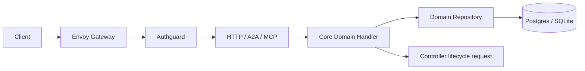

# API Services

[中文](overview_ZH.md) · [Architecture overview](../../overview.md)

**Status:** Current architecture specification.

The API is the platform control-plane protocol boundary and consists of HTTP,
A2A, and MCP adapters. All three reuse business logic from
`src/core/src/modules/<domain>/handler`; they do not duplicate authorization,
validation, or persistence rules. HTTP exposes the complete necessary CRUD
surface. A2A and MCP expose only bounded capabilities required by agent use
cases.

## Responsibilities

- Verify Authguard-signed identity and apply tenant authorization without
  implementing local user, tenant, or IAM CRUD.
- Manage Sigbot workflow, connection, and Controller worker configuration.
- Persist immutable run snapshots and invoke explicit start, stop, and status
  operations through handlers.
- Serve workflow metrics, event/log tracing, notifications, market views, and
  worker configuration to the Web application.
- Standardize pagination, error envelopes, idempotency keys, W3C Trace Context,
  and audit fields.
- Generate OpenAPI from real HTTP routes. Swagger UI assets are bundled with
  the binary and are not downloaded during builds.

The API does not deploy pods or containers, ingest market data, run strategies,
submit trades, or spell SQL directly. The independent Controller manages the
nine tenant components from persisted desired state.

## Invocation boundary

A route, tool, or skill adapter performs protocol conversion only. A handler
is the business service layer, and a repository is the database CRUD layer.
Each domain fact has one designated handler/repository transaction writer.
Components use that same handler for configuration reads or status writes and
do not create another SQL path.

## Resource scope

| Resource | API capability | Sole write boundary |
| --- | --- | --- |
| Workflow / run snapshot | CRUD, validation, start/stop, observation | Workflow handler/repository |
| Connection | CRUD and Secret-reference validation | Controller handler/repository |
| Worker / dynamic middleware | CRUD, defaults, health status | Controller handler/repository |
| Market / evaluation / log / notification reads | Bounded queries and cursors | Owning domain handler/repository |
| Identities, users, tenants, roles, permissions | No local CRUD | Authguard |

Every resource carries an explicit `tenant_id`. A process-global current user,
implicit default tenant, or second workspace identifier is forbidden. Entity
IDs and `run_id` use UUIDv7. `run_id` owns business idempotency and public
correlation; Trace Context owns observability propagation only.

## Security and failure invariants

- Unauthenticated, forged, cross-tenant, or unauthorized requests are rejected
  before a business transaction begins.
- Only external Secret key references are stored. Responses, logs, and workflow
  snapshots never contain plaintext credentials.
- A write succeeds only after its transaction commits. Asynchronous publication
  uses an outbox in that same transaction.
- Retries retain `run_id`, increment `attempt_no`, and create a new span. No
  second correlation identifier is introduced.
- The management listener exposes private health and metrics only and has no
  write operations.

## Source map

- HTTP: `src/api/http/`
- A2A: `src/api/a2a/`
- MCP: `src/api/mcp/`
- Handlers and repositories: `src/core/src/modules/`
- Identity context: `src/core/src/context/`
- OpenAPI and Swagger: `src/api/http/src/swagger/`
- Process startup: `src/cmd/src/startup/api.rs`
- Migrations: `migration/`
