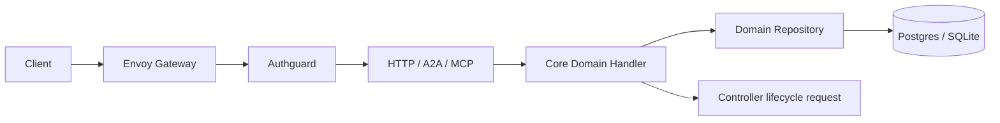

# API 服务

[English](overview.md) · [架构总览](../../overview_ZH.md)

**状态：** 当前架构规范。

API 是平台控制面的协议边界，由 HTTP、A2A 和 MCP 三个 Adapter 组成。它们复用
`src/core/src/modules/<domain>/handler` 的业务逻辑，不复制授权、校验或持久化规则。
HTTP 提供完整且必要的 CRUD；A2A 与 MCP 只按 Agent 场景暴露受控能力。

## 职责

- 校验 Authguard 签名身份并执行租户级授权；不实现用户、Tenant 或 IAM CRUD。
- 管理 Workflow、Connection、Controller Worker 等 Sigbot 业务配置。
- 保存不可变 Run Snapshot，并通过 Handler 触发明确的启动、停止和状态操作。
- 为 Web 提供 Workflow 指标、事件/日志追踪、通知、行情与 Worker 配置读写接口。
- 统一分页、错误 Envelope、幂等键、W3C Trace Context 和审计字段。
- 从实际 HTTP Route 生成 OpenAPI；Swagger UI 资源随二进制打包，不在构建时下载。

API 不部署 Pod/Container，不摄取行情，不执行策略，不提交交易，也不直接拼写 SQL。
独立 Controller 根据已持久化配置管理九个租户级组件。

## 调用边界

Route/Tool/Skill Adapter 只负责协议转换。Handler 是业务 Service 层，Repository 是
数据库 CRUD 层；一个领域事实只能由其指定 Handler/Repository 事务写入。组件需要查询
配置或提交状态时调用同一个 Handler，不另建 SQL 路径。

## 资源范围

| 资源 | API 能力 | 唯一写入边界 |
| --- | --- | --- |
| Workflow / Run Snapshot | CRUD、校验、启动/停止、观测 | Workflow Handler/Repository |
| Connection | CRUD、Secret 引用校验 | Controller Handler/Repository |
| Worker / 动态中间件 | CRUD、默认配置、健康状态 | Controller Handler/Repository |
| Market / Evaluation / Log / Notification 读取 | 有界查询与游标 | 对应领域 Handler/Repository |
| 身份、用户、Tenant、Role、Permission | 不提供本地 CRUD | Authguard |

所有资源都使用显式 `tenant_id`；不存在全局当前用户、隐式默认租户或第二个工作区 ID。
实体 ID 与 `run_id` 使用 UUIDv7。`run_id` 负责业务幂等与公开关联，Trace Context 只负责
可观测传播。

## 安全与故障不变量

- 未认证、伪造签名、跨租户或未授权请求在进入业务事务前拒绝。
- Secret 只保存外部 Secret Key 引用；响应、日志和 Workflow Snapshot 不含明文凭据。
- 写请求在事务提交后才成功；需要异步发布时与 Outbox 同事务。
- 重试保留 `run_id`、递增 `attempt_no` 并创建新 Span；不创建另一套关联 ID。
- Management 端口只暴露私网 Health/Metrics，不提供写操作。

## 源码地图

- HTTP：`src/api/http/`
- A2A：`src/api/a2a/`
- MCP：`src/api/mcp/`
- Handler/Repository：`src/core/src/modules/`
- 身份上下文：`src/core/src/context/`
- OpenAPI/Swagger：`src/api/http/src/swagger/`
- 进程启动：`src/cmd/src/startup/api.rs`
- 迁移：`migration/`
