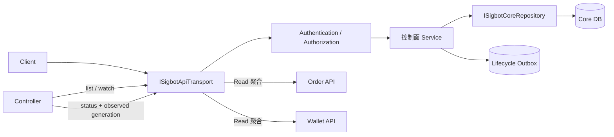

# APIServer

[English](overview.md) · [架构总览](../../overview_ZH.md)

**状态：** 规范性目标架构，并明确列出当前实现缺口。

`SigbotApiServer` 是 SigBot 的控制面边界。它与 Kubernetes API Server 类似，是
唯一允许读写核心持久化数据库的组件。Controller 或 Engine 只能通过版本化 API、
Watch、不可变 Configuration Snapshot 或 Event 获取 Desired State。

## 职责

- 认证 Principal，并应用 [Tenant Governance & IAM](tenant-governance-and-iam_ZH.md)
  拥有的 Policy Contract。
- 校验、补默认值、版本化并持久化控制面资源，包括租户配置和固定
  `StrategyPipeline` Spec。
- 提供 CRUD、List、Watch、乐观并发、Status 与 Audit API。
- 仅在持久化变更提交后发布 Lifecycle Event；需要事件时使用 Transactional Outbox。
- 需要统一公共 API 时聚合 Order 与 Wallet Read API；聚合不获得其私有数据库权限。
- 从已注册 Route 生成 OpenAPI，并统一认证、校验、分页和错误 Envelope。

它不部署 Workload、不摄取行情、不运行 AI 或 Python 策略、不下单，也不更新组合
Ledger。

## 控制面契约

每个可变 Resource 都具有稳定 ID、Tenant 与可选 Namespace Scope、Spec Generation、
Resource Version、Audit Metadata 和 Status Subresource。Status Writer 不能修改
Desired-state 字段。Watch Consumer 从 Resource Version 恢复；发生压缩或缺口后先
执行完整 List。

## 扩展点

| 角色 | 契约 | 示例 |
|---|---|---|
| Service Root | `SigbotApiServer` | 基于 Axum 的进程组合 |
| Transport | `ISigbotApiTransport` | `SigbotHttpApiTransport`；可选协议 Adapter 复用同一 Application Service |
| 核心持久化 | `ISigbotCoreRepository` 及领域专用 Repository | PostgreSQL、本地开发 SQLite、显式支持场景下的 Mongo |
| Authentication | `ISigbotAuthenticator` | Password、OIDC、GitHub、Ethers Wallet |
| Authorization | `ISigbotAuthorizer` | Tenant-scoped Policy Decision 实现 |

接口只放在可替换边界。Route Handler 保持轻量，不复制 Repository、Authorization
或 Pipeline 语义。

## 数据所有权

核心数据库保存控制面 Desired State 与系统领域数据：User、Tenant、IAM、Strategy
与 Pipeline Spec、Channel/Export 配置及 Backtest Job Metadata。APIServer 独占其
Schema、Migration、Connection Pool 与 Transaction。

Order Fact 和 Portfolio Accounting 不属于核心数据库。Order Manager 与 Wallet
Manager 独占各自 Store。APIServer 只能查询它们的 Service API 或专用 Read Model，
禁止把其私有表与核心数据做 Join。

## 安全与故障不变量

- Authentication State 必须 Request-local，禁止进程级可变 Principal 状态。
- Tenant-scoped 请求进入 Handler 前必须解析 Principal、Tenant、Namespace、
  Resource 与 Action；缺少 Scope 时默认拒绝。
- Secret 与 Password Material 在响应和日志中只能写入或脱敏。
- 可重试 Side Effect 的写请求使用 Idempotency Key。
- Resource Version 冲突必须返回确定性 Conflict，不能静默覆盖新状态。
- 只有所属 Transaction 提交后才能返回成功响应。

## 实现对齐

当前源码暴露 `SigbotAPIServer`，并已有 Authentication、User、Tenant、Handler 与
Repository 基础组件。正常启动路径目前只挂载部分已有 Route；多个 Engine 进程仍
会构造 `SigbotState` 并直接访问核心 Repository；Request Identity 尚未完全
Request-local，Tenant-scoped RBAC 也未完整实现。

目标公开名称为 `SigbotApiServer`。API 缩写风格、核心数据库独占权、完整 Pipeline
Resource、List/Watch/Status 语义、Route 注册与 Policy Enforcement 都是必须完成的
对齐项。

## 源码地图

- 进程组合：`src/cmd/`
- Application Service、Route、Handler、Context 与 Repository：`src/core/`
- 系统领域类型：`src/types/src/sys/`
- 关系型 Migration：`tooling/deploy/migrations/`
