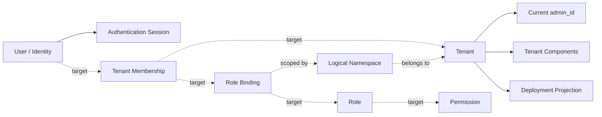

# Tenant Governance and Identity & Access Management

[中文](tenant-governance-and-iam_ZH.md) · [Documentation index](../../../index.md)

**Status:** Architecture specification. Current behavior and reserved target
design are explicitly separated.

This document is the canonical owner for system-level tenants, users,
authentication, membership, roles, permissions, namespaces, tenant keys, and
tenant-scoped runtime configuration.

## Naming and Scope

The module is named **Tenant Governance & IAM** because neither `system`,
`RBAC`, nor `IAM` alone describes the complete boundary:

- **IAM** is the industry term for identities, authentication, roles,
  permissions, and authorization policy.
- **RBAC** is one authorization model inside IAM; it does not own tenants,
  identity lifecycle, or configuration.
- **Tenant governance** adds tenant lifecycle, administrative ownership,
  isolation scopes, encryption keys, and component configuration.
- **Namespace** is a tenant-scoped authorization and isolation concept. A
  Kubernetes namespace is only one deployment projection of that concept.

API transport, deployment execution, and persistence mechanics remain in their
owning components. They consume this module's identities, scopes, and policy;
they do not redefine them.

## Physical Ownership

| Concern | Current owner | Boundary |
|---|---|---|
| Tenant and user contracts | `src/types/src/sys/` | Domain types and request/response models |
| Authentication, tenant, and user application logic | `src/core/src/sys/` | Routes, handlers, and store adapters |
| Session context and JWT handling | `src/core/src/util/auths.rs` | Authentication state and token validation |
| Tenant runtime configuration | `src/core/src/config/config_tenant.rs` | Adapts tenant component configuration into `AppConfig` |
| Tenant deployment isolation | `src/deployer/` | Current runtime projection; target ownership is the Controller runtime provider |
| Schema evolution | `tooling/deploy/migrations/` | Persistent system-domain schema |

The [APIServer](overview.md) owns HTTP composition, middleware, and core
persistence. The [Controller](../controller/overview.md) owns runtime
orchestration. This document owns the meaning and security invariants of the
data they exchange.

## Terminology

| Term | Meaning |
|---|---|
| Tenant | Top-level administrative, security, and runtime-isolation boundary |
| Identity | A user account and its linked password, OIDC, GitHub, or wallet identity |
| Principal | An authenticated user or future service identity that can receive access |
| Membership | Association between a principal and a tenant; reserved design |
| Role | Named collection of permissions; reserved design |
| Permission | Stable `resource:action` authorization capability; reserved design |
| Namespace | Tenant-owned logical resource scope; reserved as a domain entity |
| Deployment namespace | Kubernetes namespace or Docker network derived from a tenant; partially implemented |

## Capability Status

| Capability | Status | Evidence or limitation |
|---|---|---|
| User profile CRUD | Implemented | User types, handlers, routes, and PostgreSQL/SQLite/Mongo stores exist |
| Password, OIDC, GitHub, and Ethers authentication paths | Partial | Routes and token handling exist; authorization scope is absent |
| Tenant CRUD and administrative owner field | Partial | Types, routes, handlers, and stores exist; migration and field-mapping gaps remain |
| Tenant encryption keys | Implemented with security gaps | Import/generation, hashing, and optional platform-managed encrypted private keys exist |
| Tenant component configuration | Partial | Component model and persistence fields exist; runtime-provider coverage must be verified |
| Tenant runtime configuration adapter | Partial | PostgreSQL, Redis, and TimescaleDB mapping exists; encrypted passwords are not applied |
| Kubernetes namespace and Docker network projection | Partial | Current runtime code derives it from tenant identity; no logical namespace entity exists |
| Tenant membership | Reserved | No type, table, repository, route, or token claim |
| Roles, permissions, and role bindings | Reserved | No domain model, persistence, API, or endpoint enforcement |
| Managed logical namespaces | Reserved | No ownership, membership, policy, lifecycle, or API model |

Capability statements elsewhere must link to this matrix instead of claiming
that multi-tenant RBAC is already complete.

## Domain Model



Solid edges represent current concepts. Dashed edges are target design and
must not be assumed by callers until their schema, APIs, and enforcement tests
exist.

## Current Identity and Authentication

`UserInfo` stores local profile fields plus bindings for OIDC, GitHub, Google,
and Ethers identities. Current authentication code exposes password, OIDC,
GitHub, and Ethers wallet flows; a dedicated Google login route is not present.

Current user endpoints are:

| Method | Path | Purpose |
|---|---|---|
| `GET` / `POST` | `/sys/user/current` | Read or update the current user |
| `GET` | `/sys/user/query` | Query users |
| `POST` | `/sys/user/save` | Create or update a user |
| `POST` | `/sys/user/delete` | Delete a user |

Authentication routes cover password public-key exchange and verification,
OIDC and GitHub connect/callback flows, Ethers signature verification, logout,
and JWT public-key discovery.

`AuthUserClaims` currently contains `ptype`, `uid`, `uname`, `email`, `exp`, and
an optional extension map. It has no canonical tenant, membership, role,
permission, or namespace scope. Authentication therefore proves identity; it
does not establish the target authorization model.

## Current Tenant Governance

`TenantInfo` currently owns:

- identity and lifecycle metadata: `name`, `shared`, `admin_id`, properties,
  description, status, and audit fields;
- encryption material: public key, private-key hash, encrypted private key, and
  the platform-managed-key flag;
- component configuration: middleware and service deployment instances,
  connections, encrypted passwords, performance settings, deployment metadata,
  and status.

Current tenant endpoints are:

| Method | Path | Purpose |
|---|---|---|
| `GET` | `/sys/tenant/query` | Query tenants |
| `POST` | `/sys/tenant/save` | Create or update a tenant |
| `POST` | `/sys/tenant/delete` | Delete a tenant |

For a new tenant, the handler can import a matching RSA key pair or generate a
2048-bit pair. It stores the public key and private-key hash. When
platform-managed recovery is enabled, it encrypts the private key with the
system master key; a system-generated private key is returned only in the
creation response.

Tenant component passwords are encrypted with the tenant public key before
storage. Supported component contract types currently include PostgreSQL,
EMQX, Redis, TimescaleDB, Datafeed, Strategy, Backtest, and Notification.
Provider-specific support must still be verified in the runtime implementation.

## Authorization and Scope Target

The target authorization model is tenant-scoped RBAC inside IAM:

1. A principal joins a tenant through an explicit membership.
2. A role is a named set of stable `resource:action` permissions.
3. A role binding grants a role to a principal within a tenant and optionally
   within a logical namespace.
4. Platform administration is an explicit scope; it is not an implicit bypass
   created by a missing tenant identifier.
5. Every protected request resolves principal, tenant, namespace, resource,
   and action before the owning handler runs.
6. Authorization denies by default and records security-relevant decisions in
   the audit log.

Target invariants:

- A tenant-scoped resource must never be queried or mutated without a resolved
  tenant scope.
- Cross-tenant access requires an explicit platform-level permission.
- A namespace belongs to exactly one tenant and cannot widen a tenant grant.
- Authentication tokens carry stable identifiers, not copied mutable policy.
  Current grants are resolved or invalidated consistently.
- API, A2A, MCP, background jobs, and message consumers use the same policy
  decision contract.

## Runtime Isolation and Namespace Projection

The current runtime implementation derives isolation from a tenant rather than
from a managed namespace entity:

- Kubernetes mode derives `sigbot-tenant-{tenant_id}`, creates tenant resources
  inside it, and removes the namespace for a deactivated tenant.
- Docker mode derives a tenant-specific network from the configured prefix and
  tenant identifier.
- Standalone mode tracks tenant components in memory and does not provide
  equivalent resource isolation.

These deployment identifiers are implementation details. The target logical
namespace needs its own stable identity, ownership, policy, lifecycle, and
mapping to one or more runtime providers.

## Tenant-Scoped Runtime Configuration

SigBot separates cluster-level services, such as APIServer, Controller, and
shared Datafeed, from strategy-scoped Evaluator/Strategy Runner workers and
run-scoped Backtest jobs. Scoped runtimes start from shared `AppConfig` and
adapt middleware connections from tenant component configuration.

### Configuration Contract

1. `CustomConfigConfigurer` in `src/core/src/config/config.rs` defines how
   custom JSON modifies `AppConfigProperties`.
2. `DefaultTenantConfigConfigurer` in
   `src/core/src/config/config_tenant.rs` reads tenant component configuration
   and maps PostgreSQL, Redis, and TimescaleDB settings into the base
   configuration. It also accepts top-level `database` and `redis` objects.
3. `init_tenant_config(configuration)` decodes and caches tenant configuration
   once at service startup.
4. `get_tenant_config()` reads the cached configuration without arguments. If
   tenant initialization has not happened, it returns platform configuration.

```rust
// Initialize once when a tenant-level service starts.
let configuration = matches
    .get_one::<String>("STRATEGY_RUNNER_CONFIGURATION")
    .expect("tenant configuration is required");
init_tenant_config(configuration);

// Read the cached, tenant-adapted configuration afterwards.
let config = get_tenant_config();
let db_host = &config.appdb.postgres.inner.host;
```

Strategy Runner and Evaluator are current call-site examples. The adapter uses
an `ArcSwap`-backed cached configuration so callers do not repeatedly parse the
tenant JSON.

### Configuration Limitations

- Encrypted component passwords currently produce warnings and are not
  decrypted and applied by the default adapter.
- Additional middleware types require explicit mappings.
- A complete hot-update lifecycle is reserved design.
- Platform fallback is compatibility behavior, not authorization. A missing
  tenant configuration must not silently grant platform-level data access.

## Persistence and Migration Model

PostgreSQL, SQLite, and Mongo adapters exist for users and tenants. Relational
system migrations currently create `sys_user`; the checked-in tenant component
migration assumes a pre-existing `sys_tenant` table and only adds key and
component columns. No checked-in tables exist for membership, role,
permission, role binding, or logical namespace.

Schema names, repository names, and API models must converge before RBAC is
declared implemented. Mongo's schema flexibility does not replace explicit
domain contracts or migration evidence for relational providers.

## Security Invariants

- Never serialize stored password material in user responses.
- Never log credentials, JWTs, private keys, encrypted component passwords, or
  provider secrets.
- Return a generated tenant private key only through the documented one-time
  creation flow.
- Production platform-managed keys require an explicit, independent system
  master key; fallback secrets or built-in defaults are not an acceptable
  production boundary.
- Bind authenticated identity to request-local state. Process-global mutable
  identity state must not be shared across concurrent requests.
- Validate tenant membership and authorization before reading or mutating a
  tenant-scoped resource.
- Audit tenant lifecycle, identity binding, role/permission changes, denied
  authorization, and key-management operations.

## Known Gaps

The following are implementation gaps, not supported capabilities:

- No tenant membership, role, permission, role-binding, or logical namespace
  domain model exists.
- JWT claims and endpoint middleware do not currently establish tenant or RBAC
  scope.
- `SecurityContext` is process-global rather than request-local, creating a
  concurrency isolation risk.
- Checked-in migrations do not create the base `sys_tenant` table, while a
  later migration assumes it exists.
- Tenant PostgreSQL insert naming and later `sys_tenant` operations are not
  consistent.
- `SaveTenantRequest::to_tenant()` does not currently preserve all submitted
  tenant metadata fields.
- Platform-managed-key defaults differ between handler behavior and schema
  defaults, and current code permits weak fallback master-key sources.
- User response types include the password field and require explicit
  redaction boundaries.
- The password-verification lookup and OpenAPI path registration require
  reconciliation with the intended API surface.
- Tenant component password decryption and configuration hot updates remain
  incomplete.

## Evolution Rules

- Add schema, contracts, persistence, handlers, enforcement, audit events, and
  integration tests as one cohesive slice for each IAM capability.
- Do not encode authorization only in API routes; non-HTTP entry points must
  use the same policy decision boundary.
- Do not use a Kubernetes namespace name as the durable logical namespace ID.
- Keep runtime-provider details in Controller and core persistence mechanics in
  APIServer; link to this document for tenant and access semantics.
- Update the capability matrix whenever source and tests move a feature from
  reserved to implemented.
