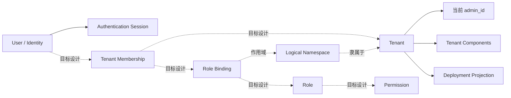

# 租户治理与身份访问管理

[English](tenant-governance-and-iam.md) · [文档索引](../../../index_ZH.md)

**状态：** 架构规范。当前行为与保留目标设计已明确分开。

本文是系统级 Tenant、User、认证、成员关系、Role、Permission、Namespace、
租户密钥和租户级运行配置的唯一规范归属。

## 命名与范围

模块命名为 **Tenant Governance & IAM（租户治理与身份访问管理）**，因为
`system`、`RBAC` 或单独的 `IAM` 都无法完整表达其边界：

- **IAM** 是身份、认证、角色、权限和授权策略的行业通用术语。
- **RBAC** 只是 IAM 内部的一种授权模型，不负责 Tenant、身份生命周期和配置。
- **Tenant Governance** 补充租户生命周期、管理归属、隔离作用域、加密密钥和
  组件配置。
- **Namespace** 是租户级授权与隔离作用域；Kubernetes Namespace 只是它的一种
  部署投影。

API 传输、部署执行和持久化机制仍由各物理组件负责。它们消费本文定义的身份、
作用域与策略，不重复定义这些概念。

## 物理归属

| 关注点 | 当前归属 | 边界 |
|---|---|---|
| Tenant 与 User 契约 | `src/types/src/sys/` | 领域类型与请求/响应模型 |
| 认证、Tenant 与 User 应用逻辑 | `src/core/src/sys/` | Route、Handler 与 Store Adapter |
| Session Context 与 JWT | `src/core/src/util/auths.rs` | 认证状态与 Token 校验 |
| 租户运行配置 | `src/core/src/config/config_tenant.rs` | 将租户组件配置适配到 `AppConfig` |
| 租户部署隔离 | `src/deployer/` | 当前 Runtime Projection；目标归属为 Controller Runtime Provider |
| Schema 演进 | `tooling/deploy/migrations/` | 系统领域持久化结构 |

[APIServer](overview_ZH.md) 负责 HTTP 组合、Middleware 与核心持久化，
[Controller](../controller/overview_ZH.md) 负责运行时编排。本文负责它们交换数据的
语义与安全不变量。

## 术语

| 术语 | 含义 |
|---|---|
| Tenant | 顶层管理、安全与运行时隔离边界 |
| Identity | 用户账号及其绑定的密码、OIDC、GitHub 或 Wallet 身份 |
| Principal | 可以获得访问权限的已认证用户或未来 Service Identity |
| Membership | Principal 与 Tenant 的关联；保留设计 |
| Role | 一组具名 Permission；保留设计 |
| Permission | 稳定的 `resource:action` 授权能力；保留设计 |
| Namespace | Tenant 所属的逻辑资源作用域；作为领域实体属于保留设计 |
| Deployment Namespace | 从 Tenant 派生的 Kubernetes Namespace 或 Docker Network；部分实现 |

## 能力状态

| 能力 | 状态 | 证据或限制 |
|---|---|---|
| User Profile CRUD | 已实现 | 已有 User 类型、Handler、Route 及 PostgreSQL/SQLite/Mongo Store |
| Password、OIDC、GitHub 与 Ethers 认证路径 | 部分实现 | 已有 Route 与 Token 处理，但缺少授权作用域 |
| Tenant CRUD 与管理员字段 | 部分实现 | 已有类型、Route、Handler 与 Store，但 Migration 和字段映射仍有缺口 |
| 租户加密密钥 | 已实现但有安全缺口 | 已有导入/生成、Hash 及可选的平台托管加密私钥 |
| 租户组件配置 | 部分实现 | 已有组件模型和持久化字段，需逐项验证 Runtime Provider 覆盖 |
| 租户运行配置适配器 | 部分实现 | 已有 PostgreSQL、Redis、TimescaleDB 映射，但未应用加密密码 |
| Kubernetes Namespace 与 Docker Network 投影 | 部分实现 | 当前 Runtime Code 可按 Tenant 派生；没有逻辑 Namespace 实体 |
| Tenant Membership | 保留设计 | 无类型、表、Repository、Route 或 Token Claim |
| Role、Permission 与 Role Binding | 保留设计 | 无领域模型、持久化、API 或端点级 Enforcement |
| 可管理逻辑 Namespace | 保留设计 | 无 Ownership、Membership、Policy、Lifecycle 或 API 模型 |

其他文档必须链接本状态矩阵，不得再宣称多租户 RBAC 已完整实现。

## 领域模型



实线表示当前已有概念，虚线表示目标设计。在对应 Schema、API 和 Enforcement
测试落地前，调用方不得假设虚线能力存在。

## 当前身份与认证

`UserInfo` 保存本地 Profile 字段以及 OIDC、GitHub、Google 和 Ethers 身份绑定。
当前认证代码提供 Password、OIDC、GitHub 和 Ethers Wallet 流程；尚无独立的
Google 登录 Route。

当前 User 端点为：

| Method | Path | 用途 |
|---|---|---|
| `GET` / `POST` | `/sys/user/current` | 读取或更新当前用户 |
| `GET` | `/sys/user/query` | 查询用户 |
| `POST` | `/sys/user/save` | 新建或更新用户 |
| `POST` | `/sys/user/delete` | 删除用户 |

认证 Route 覆盖 Password Public Key 交换与验证、OIDC 与 GitHub
Connect/Callback、Ethers 签名校验、Logout 及 JWT Public Key 获取。

`AuthUserClaims` 当前只有 `ptype`、`uid`、`uname`、`email`、`exp` 和可选扩展
Map，没有规范化的 Tenant、Membership、Role、Permission 或 Namespace Scope。
因此当前认证只能证明身份，尚不能建立目标授权模型。

## 当前租户治理

`TenantInfo` 当前拥有：

- 身份与生命周期元数据：`name`、`shared`、`admin_id`、Properties、Description、
  Status 与审计字段；
- 加密材料：Public Key、Private Key Hash、加密 Private Key 和平台托管标记；
- 组件配置：Middleware 与 Service 部署实例、Connection、加密密码、性能参数、
  Deployment Metadata 与状态。

当前 Tenant 端点为：

| Method | Path | 用途 |
|---|---|---|
| `GET` | `/sys/tenant/query` | 查询 Tenant |
| `POST` | `/sys/tenant/save` | 新建或更新 Tenant |
| `POST` | `/sys/tenant/delete` | 删除 Tenant |

新建 Tenant 时，Handler 可以导入匹配的 RSA Key Pair，也可以生成 2048-bit
Key Pair。系统保存 Public Key 与 Private Key Hash；启用平台托管恢复时，使用
System Master Key 加密 Private Key。系统生成的 Private Key 只在创建响应中返回
一次。

租户组件密码在保存前使用 Tenant Public Key 加密。当前组件契约类型包括
PostgreSQL、EMQX、Redis、TimescaleDB、Datafeed、Strategy、Backtest 与
Notification；具体 Provider 支持仍需在 Runtime 实现中逐项验证。

## 授权与作用域目标

目标授权模型是在 IAM 内实现 Tenant-scoped RBAC：

1. Principal 通过显式 Membership 加入 Tenant。
2. Role 是一组稳定 `resource:action` Permission 的具名集合。
3. Role Binding 在 Tenant 内、并可选在逻辑 Namespace 内向 Principal 授予 Role。
4. Platform Administration 是显式作用域，不能因缺少 Tenant ID 而隐式绕过。
5. 每个受保护请求必须在进入业务 Handler 前解析 Principal、Tenant、Namespace、
   Resource 和 Action。
6. 授权默认拒绝，并将安全相关决策写入 Audit Log。

目标不变量：

- 未解析 Tenant Scope 时，禁止查询或修改 Tenant-scoped Resource。
- 跨 Tenant 访问必须具有显式 Platform-level Permission。
- Namespace 只能属于一个 Tenant，且不能扩大 Tenant Grant。
- Token 携带稳定标识符，而不是复制可变 Policy；当前授权变更必须能够一致地
  重新解析或失效。
- API、A2A、MCP、Background Job 与 Message Consumer 使用同一 Policy Decision
  Contract。

## 运行时隔离与 Namespace 投影

当前 Runtime 实现从 Tenant 派生运行时隔离，而不是消费可管理的 Namespace 实体：

- Kubernetes 模式派生 `sigbot-tenant-{tenant_id}`，在其中创建租户资源，并在
  Tenant 停用时删除整个 Namespace。
- Docker 模式从配置的 Prefix 与 Tenant ID 派生 Tenant-specific Network。
- Standalone 模式只在内存中跟踪租户组件，不提供等价的资源隔离。

这些部署标识属于实现细节。目标逻辑 Namespace 需要独立的稳定 ID、Ownership、
Policy、Lifecycle，以及到一个或多个 Runtime Provider 的映射。

## 租户级运行配置

SigBot 将 APIServer、Controller、共享 Datafeed 等 Cluster-level Service，与
Strategy-scoped Evaluator/Strategy Runner Worker、Run-scoped Backtest Job 分离。
Scoped Runtime 从共享 `AppConfig` 启动，再根据 Tenant Component Configuration
适配 Middleware Connection。

### 配置契约

1. `src/core/src/config/config.rs` 中的 `CustomConfigConfigurer` 定义 Custom JSON
   如何修改 `AppConfigProperties`。
2. `src/core/src/config/config_tenant.rs` 中的
   `DefaultTenantConfigConfigurer` 读取租户组件配置，将 PostgreSQL、Redis 和
   TimescaleDB 映射到基础配置；同时接受顶层 `database` 与 `redis` Object。
3. `init_tenant_config(configuration)` 在服务启动时解码并缓存一次租户配置。
4. `get_tenant_config()` 无参读取缓存；尚未初始化租户配置时返回 Platform
   Configuration。

```rust
// Tenant-level Service 启动时初始化一次。
let configuration = matches
    .get_one::<String>("STRATEGY_RUNNER_CONFIGURATION")
    .expect("tenant configuration is required");
init_tenant_config(configuration);

// 后续读取缓存的租户适配配置。
let config = get_tenant_config();
let db_host = &config.appdb.postgres.inner.host;
```

Strategy Runner 与 Evaluator 是当前调用示例。Adapter 使用基于 `ArcSwap` 的缓存，
避免调用方反复解析 Tenant JSON。

### 配置限制

- 加密组件密码当前只触发 Warning，默认 Adapter 尚未解密并应用。
- 其他 Middleware 类型需要显式增加映射。
- 完整配置 Hot Update Lifecycle 属于保留设计。
- Platform Fallback 是兼容行为，不是授权行为；缺少租户配置时不得静默获得
  Platform-level 数据访问。

## 持久化与 Migration 模型

User 与 Tenant 已有 PostgreSQL、SQLite 和 Mongo Adapter。当前关系型系统
Migration 只创建 `sys_user`；仓库中的 Tenant Component Migration 假设
`sys_tenant` 已存在，只增加 Key 与 Components 字段。Membership、Role、
Permission、Role Binding 和逻辑 Namespace 均无仓库内建表脚本。

在宣称 RBAC 已实现前，Schema Name、Repository Name 与 API Model 必须收敛。
Mongo 的 Schema Flexibility 不能替代明确的领域契约，也不能替代关系型 Provider
的 Migration 证据。

## 安全不变量

- User Response 禁止序列化已存储的 Password Material。
- 禁止记录 Credential、JWT、Private Key、加密组件密码或 Provider Secret。
- 生成的 Tenant Private Key 只能通过有文档约束的一次性创建流程返回。
- 生产环境的平台托管 Key 必须使用显式且独立的 System Master Key；Fallback
  Secret 或内置默认值不能作为生产安全边界。
- 已认证 Identity 必须绑定到 Request-local State，不得在并发请求间共享进程级
  Mutable Identity State。
- 读取或修改 Tenant-scoped Resource 前必须验证 Membership 与 Authorization。
- Tenant Lifecycle、Identity Binding、Role/Permission 变更、拒绝授权及 Key
  Management 操作必须进入 Audit Log。

## 已知缺口

以下均为实现缺口，不是已支持能力：

- 没有 Tenant Membership、Role、Permission、Role Binding 或逻辑 Namespace
  领域模型。
- JWT Claim 与端点 Middleware 尚未建立 Tenant 或 RBAC Scope。
- `SecurityContext` 是进程级全局状态而不是 Request-local State，存在并发隔离风险。
- 仓库内 Migration 未创建基础 `sys_tenant`，但后续 Migration 假设它已存在。
- Tenant PostgreSQL Insert Name 与后续 `sys_tenant` 操作不一致。
- `SaveTenantRequest::to_tenant()` 当前未保留全部提交的 Tenant Metadata 字段。
- Handler 与 Schema 对平台托管 Key 的默认值不一致，当前代码还允许弱
  Master-key Fallback 来源。
- User Response Type 包含 Password 字段，需要显式脱敏边界。
- Password Verification Lookup 与 OpenAPI Path 注册仍需和预期 API Surface 对账。
- Tenant Component Password 解密与配置 Hot Update 尚未完成。

## 演进规则

- 每项 IAM 能力必须将 Schema、Contract、Persistence、Handler、Enforcement、
  Audit Event 和 Integration Test 作为一个高内聚切片实现。
- 授权不能只编码在 API Route；非 HTTP 入口也必须使用同一 Policy Decision
  Boundary。
- 禁止把 Kubernetes Namespace Name 当作长期逻辑 Namespace ID。
- Runtime Provider 细节归 Controller，核心持久化机制归 APIServer；Tenant 与访问
  语义统一链接本文。
- 源码与测试将能力从保留设计推进到已实现时，必须同步更新能力状态矩阵。
