# Backtest

[中文](overview_ZH.md) · [Architecture overview](../../overview.md)

**Status:** Normative target architecture. Current backtest managers do not yet
implement the complete run.

`SigbotBacktestRunner` evaluates historical economic behavior by composing the
same feed, evaluation, deterministic strategy, order, exchange, and portfolio
contracts used by live trading with run-scoped simulation adapters. It is not a
duplicate Datafeed service, a duplicate exchange microservice, or an E2E test.

## Run-scoped Composition

```mermaid
flowchart LR
    Clock[SigbotVirtualClock] --> Replay[SigbotHistoricalReplaySource]
    Replay -->|SigbotFeedEvent| Eval[Evaluator mode]
    Replay -->|SigbotFeedEvent| Strategy[Strategy core]
    Eval -->|SigbotEvaluationSnapshot| Strategy
    Strategy -->|SigbotTradeSignal| Order[Order core]
    Order --> Sim[SigbotSimulatedExchangeClient]
    Sim -->|execution facts| Ledger[Run-scoped Portfolio Ledger]
    Ledger -->|SigbotPortfolioSnapshot| Strategy
    Ledger --> Metrics[Performance metrics]
```

One isolated `BacktestSession` owns virtual time, input range, pipeline and
artifact versions, deterministic seed, evaluator mode, simulation policy,
event journal, run database/namespace, checkpoints, result, and cancellation
state. Parallel runs share no mutable strategy or portfolio state.

## Simulation Adapters

| Capability | Live implementation | Backtest implementation |
|---|---|---|
| Market source | External `ISigbotDatafeedSource` through shared Datafeed | `SigbotHistoricalReplaySource` reading canonical archived events |
| Clock | `SigbotSystemClock` | `SigbotVirtualClock` |
| Venue | Provider `ISigbotExchangeClient` | `SigbotSimulatedExchangeClient` |
| Portfolio | Wallet service | Run-scoped implementation of the same accounting contracts |
| Transport | Local or MQTT Messager | Isolated local event bus by default |

The replay source reads normalized kline, trade, order-book, funding, and
approved news events. It does not reconnect to live Binance/Twitter providers;
testing ingestion adapters and real middleware is E2E scope.

The simulated exchange—not an “Exchanger”—owns venue behavior: matching,
market/limit/stop orders, partial fills, rejections, latency, slippage, fees,
funding, margin, cancellation, and forced liquidation. Accounting effects are
applied by the run-scoped portfolio ledger rather than duplicated inside the
exchange simulator.

## Evaluator Modes

| Mode | Evaluation behavior | Purpose | Reproducibility |
|---|---|---|---|
| `FIXED` | Use one fixed, versioned evaluation/parameter snapshot | Isolate deterministic Python strategy behavior | Deterministic |
| `REPLAY` | Replay recorded `SigbotEvaluationSnapshot` events at their original publication/effective time | Default high-fidelity pipeline regression | Deterministic |
| `RECOMPUTE` | Run the AI Evaluator against only data visible under virtual time | Research the AI-plus-strategy system | Explicitly non-deterministic |

Because the production strategy depends on evaluation, the default cannot
silently omit it. `REPLAY` preserves the actual historical AI advice while
allowing strategy, risk, and execution logic to be reproduced. `RECOMPUTE`
records model/provider, model version, prompt/tool versions, temperature, seed
when available, and the complete evaluation artifact; results should be
reported as a distribution across runs rather than as one deterministic score.

## Event Time and Look-ahead Safety

- Events are ordered by source event time with a deterministic tie-breaker.
- An evaluation is visible only at or after its original `published_at` and
  `valid_from`; its input watermark cannot exceed the strategy decision event.
- A portfolio snapshot is visible only after the simulated transaction that
  produced it commits.
- Tools in `RECOMPUTE` mode receive the virtual clock and cannot access current
  live market data.
- Gaps, corrections, delistings, corporate actions, and funding schedules are
  explicit dataset events, not silently repaired with future data.

## Extension Points

| Role | Contract | Implementation |
|---|---|---|
| Service root | `SigbotBacktestRunner` | One isolated process/job per run or worker slot |
| Engine | `ISigbotBacktestEngine` | `SigbotEventDrivenBacktestEngine` |
| Clock | `ISigbotClock` | `SigbotVirtualClock` |
| Historical feed | `ISigbotDatafeedSource` | `SigbotHistoricalReplaySource` |
| Simulated venue | `ISigbotExchangeClient` | `SigbotSimulatedExchangeClient` |

## Results and Invariants

Results include immutable input/configuration hashes, event/fill journal,
equity curve, return, drawdown, risk-adjusted metrics, turnover, fees, funding,
liquidations, win/loss statistics, and failure/cancellation state.

- Rerunning `FIXED` or `REPLAY` with identical artifacts and engine version
  yields byte-equivalent decisions and accounting results.
- No simulation event can mutate live Order or Wallet stores or use live
  trading credentials.
- Cancellation is cooperative and checkpoints are consistent at event
  boundaries.
- Execution and accounting use decimal arithmetic and the same validation
  contracts as live mode.
- Backtest measures strategy economics; E2E tests process boundaries, broker,
  databases, deployment, and adapter integration. One does not substitute for
  the other.

## Implementation Alignment

Current source exposes `SigbotBacktestServer`, `ISigbotBacktestManager`, and
KLINE/TRADES managers. Their processing paths are unimplemented and scheduled
runs can require an uninjected distributed-lock handler. Virtual time,
canonical replay, simulated exchange behavior, evaluator modes, isolated
accounting, and reproducible result artifacts are not yet complete.

Required alignment is the run-scoped composition above. It replaces duplicated
Datafeed/Exchange/Wallet responsibilities with common ports and simulation
adapters.

## Source Map

- Backtest service and managers: `src/backtest/`
- Strategy execution: `src/strategy/`
- Exchange contracts: `src/exchange/`
- Wallet accounting contracts: `src/wallet/`
