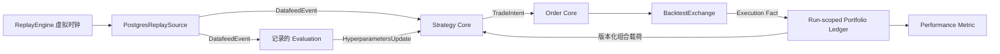

# Backtest

[English](overview.md) · [架构总览](../../overview_ZH.md)

**状态：** 已实现确定性回放与模拟执行组件；真实深度、部分流动性和延迟建模仍是有界缺口。

`SigbotBacktestServer` 通过 Run-scoped Simulation Adapter 组合 Live Trading 使用的
相同 Feed、Evaluation、确定性 Strategy、Order、Exchange 与 Portfolio Contract，
评估历史经济行为。它不是重复 Datafeed Service、重复 Exchange 微服务，也不是 E2E
Test。

## Run-scoped 组合

每个隔离的 Run-scoped Replay Runtime 拥有 Virtual Time、Input Range、Workflow/Artifact Version、
Deterministic Seed、Evaluator Mode、Simulation Policy、Event Journal、Run
Database/Namespace、Checkpoint、Result 与 Cancellation State。并行 Run 不共享可变
Strategy 或 Portfolio State。

## Simulation Adapter

| Capability | Live 实现 | Backtest 实现 |
|---|---|---|
| Market Source | Live Datafeed 组件的 `IDatafeed` | 读取规范归档事件的 `PostgresReplaySource` |
| Clock | Live 服务边界的 Wall Clock | `ReplayEngine` 拥有的 Virtual Clock |
| Venue | Provider `IExchange` | `BacktestExchange` |
| Portfolio | Wallet Service | 实现相同会计契约的 Run-scoped Ledger |
| Transport | Local 或 MQTT Messager | 默认隔离 Local Event Bus |

Replay Source 读取规范 Kline、Trade、Order-book、Funding 与获准 News Event，不重新
连接 Live Binance/Twitter Provider；测试 Ingestion Adapter 与真实 Middleware 属于
E2E 范围。

模拟交易所（不是 “Exchanger”）拥有当前已实现的 Venue 行为：Market Execution、后续
Tick 触发 Resting Limit Crossing、配置化 Slippage/Fee、Acknowledgement 和确定性
Execution Fact。会计影响由 Run-scoped Portfolio Ledger 应用，不能复制到 Exchange
Simulator 内部。Stop Order、部分流动性、Latency、Funding、Margin、Cancellation Race
和 Forced Liquidation 仍是明确模型缺口。

## Evaluator Replay Policy

| Policy | Evaluation 行为 | 当前状态 | 可复现性 |
|---|---|---|---|
| 固定 Fixture | 重放一个已记录、带版本的 `HyperparametersUpdate` Fixture | 通过记录 Artifact 支持 | 确定 |
| 记录流 | 按原始 Publish/Effective Time 重放已记录更新 | 已实现的默认路径 | 确定 |
| 重新计算 | 只使用 Virtual Time 可见数据重新运行 Evaluator | 预留增强，当前没有 Runtime Mode | 将是非确定 |

Production Strategy 依赖 Evaluation，因此默认路径不能静默跳过它。已实现的记录流保留
历史 AI 建议，同时可复现 Strategy、Risk 与 Execution Logic。未来重新计算路径必须记录
Model/Provider、Model Version、Prompt/Tool Version、Temperature、可用 Seed 与完整
Evaluation Artifact；结果应报告多次 Run 分布，不能伪装成单一确定分数。

## Event Time 与未来函数防护

- Event 按 Source Event Time 和确定性 Tie-breaker 排序。
- Evaluation 只有在原始 `published_at` 与 `valid_from` 之后可见，且 Input Watermark
  不能超过 Strategy Decision Event。
- Portfolio Snapshot 只有在生成它的模拟 Transaction Commit 后可见。
- 未来重新计算 Tool 必须接收 Virtual Clock，禁止访问当前 Live Market Data。
- Gap、Correction、Delisting、Corporate Action 与 Funding Schedule 都是显式 Dataset
  Event，禁止用未来数据静默修复。

## 扩展点

| 角色 | 契约 | 实现 |
|---|---|---|
| Service Root | `SigbotBacktestServer` | 组件启动与 Provider 注册 |
| Engine | `ReplayEngine` | 虚拟时间投递与 Barrier 协调 |
| Replay Port | `ReplaySource`、`ReplayDecision` | 历史输入与决策投递 |
| Historical Feed | `PostgresReplaySource` | Canonical 持久事件的 Keyset 读取 |
| Backtest Venue | `IExchange` | `BacktestExchange` |

## 结果与不变量

当前耐久结果面包括冻结输入 Identity、Replay Cursor/Checkpoint、Virtual Clock、模拟
Order/Execution Fact、Outbox 与 Wallet 会计状态。Equity Curve、Drawdown/Risk-adjusted
Summary、Turnover 和 Win/Loss Analytics 应由 Reporting Layer 派生；Backtest 组件尚未
持久化完整 Performance Report Model。

- 相同 Artifact 与 Engine Version 的固定 Fixture/记录流重跑必须产生字节等价的
  Decision 与 Accounting Result。
- Simulation Event 禁止修改 Live Order/Wallet Store 或使用 Live Trading Credential。
- Checkpoint 在 Event Boundary 上一致；完整用户侧 Cancellation/Result 状态机仍待增强。
- Execution 与 Accounting 使用 Decimal Arithmetic，并复用 Live Validation Contract。
- Backtest 衡量 Strategy Economics；E2E 验证 Process Boundary、Broker、Database、
  Deployment 与 Adapter Integration，二者不能互相替代。

## 实现对齐

`SigbotBacktestServer` 已组合持久历史、虚拟时钟、回放屏障、已记录 Evaluation、正常
Strategy 回调和专用模拟执行 Adapter。普通限价单由后续持久 Tick 按固定顺序、配置费用
和滑点撮合；Execution 与 Outbox 同事务提交。重复/迟到输入和进程重启不会产生第二笔成交。

当前全量成交模型明确不宣称订单簿队列优先级、部分可用流动性、Venue 网络延迟或全部
分布式模型分片等价；这些属于后续增强，而不是隐藏能力。

## 源码地图

- Backtest 数据面组件：`src/component/backtest/`
- Backtest Repository：`src/core/src/modules/backtest/storage/`
- Strategy Execution：`src/component/strategy/`
- Exchange Contract：`src/exchange/`
- Wallet Accounting Contract：`src/component/wallet/`
