# Backtest

[English](overview.md) · [架构总览](../../overview_ZH.md)

**状态：** 规范性目标架构；当前 Backtest Manager 尚未实现完整 Run。

`SigbotBacktestRunner` 通过 Run-scoped Simulation Adapter 组合 Live Trading 使用的
相同 Feed、Evaluation、确定性 Strategy、Order、Exchange 与 Portfolio Contract，
评估历史经济行为。它不是重复 Datafeed Service、重复 Exchange 微服务，也不是 E2E
Test。

## Run-scoped 组合

```mermaid
flowchart LR
    Clock[SigbotVirtualClock] --> Replay[SigbotHistoricalReplaySource]
    Replay -->|SigbotFeedEvent| Eval[Evaluator Mode]
    Replay -->|SigbotFeedEvent| Strategy[Strategy Core]
    Eval -->|SigbotEvaluationSnapshot| Strategy
    Strategy -->|SigbotTradeSignal| Order[Order Core]
    Order --> Sim[SigbotSimulatedExchangeClient]
    Sim -->|Execution Fact| Ledger[Run-scoped Portfolio Ledger]
    Ledger -->|SigbotPortfolioSnapshot| Strategy
    Ledger --> Metrics[Performance Metric]
```

每个隔离 `BacktestSession` 拥有 Virtual Time、Input Range、Pipeline/Artifact Version、
Deterministic Seed、Evaluator Mode、Simulation Policy、Event Journal、Run
Database/Namespace、Checkpoint、Result 与 Cancellation State。并行 Run 不共享可变
Strategy 或 Portfolio State。

## Simulation Adapter

| Capability | Live 实现 | Backtest 实现 |
|---|---|---|
| Market Source | 共享 Datafeed 中的外部 `ISigbotDatafeedSource` | 读取规范归档事件的 `SigbotHistoricalReplaySource` |
| Clock | `SigbotSystemClock` | `SigbotVirtualClock` |
| Venue | Provider `ISigbotExchangeClient` | `SigbotSimulatedExchangeClient` |
| Portfolio | Wallet Service | 实现相同会计契约的 Run-scoped Ledger |
| Transport | Local 或 MQTT Messager | 默认隔离 Local Event Bus |

Replay Source 读取规范 Kline、Trade、Order-book、Funding 与获准 News Event，不重新
连接 Live Binance/Twitter Provider；测试 Ingestion Adapter 与真实 Middleware 属于
E2E 范围。

模拟交易所（不是 “Exchanger”）拥有 Venue 行为：Matching、Market/Limit/Stop Order、
Partial Fill、Rejection、Latency、Slippage、Fee、Funding、Margin、Cancellation 与
Forced Liquidation。会计影响由 Run-scoped Portfolio Ledger 应用，不能复制到 Exchange
Simulator 内部。

## Evaluator 模式

| Mode | Evaluation 行为 | 用途 | 可复现性 |
|---|---|---|---|
| `FIXED` | 使用一个固定且版本化的 Evaluation/Parameter Snapshot | 隔离评估确定性 Python Strategy | 确定 |
| `REPLAY` | 按原始 Publish/Effective Time 重放已记录 `SigbotEvaluationSnapshot` | 默认高保真 Pipeline Regression | 确定 |
| `RECOMPUTE` | 仅使用 Virtual Time 下可见数据重新运行 AI Evaluator | 研究 AI + Strategy 系统 | 明确非确定 |

Production Strategy 依赖 Evaluation，因此默认模式不能静默跳过它。`REPLAY` 保留真实
历史 AI 建议，同时可复现 Strategy、Risk 与 Execution Logic。`RECOMPUTE` 必须记录
Model/Provider、Model Version、Prompt/Tool Version、Temperature、可用 Seed 与完整
Evaluation Artifact；结果应报告多次 Run 分布，不能伪装成单一确定分数。

## Event Time 与未来函数防护

- Event 按 Source Event Time 和确定性 Tie-breaker 排序。
- Evaluation 只有在原始 `published_at` 与 `valid_from` 之后可见，且 Input Watermark
  不能超过 Strategy Decision Event。
- Portfolio Snapshot 只有在生成它的模拟 Transaction Commit 后可见。
- `RECOMPUTE` Tool 接收 Virtual Clock，禁止访问当前 Live Market Data。
- Gap、Correction、Delisting、Corporate Action 与 Funding Schedule 都是显式 Dataset
  Event，禁止用未来数据静默修复。

## 扩展点

| 角色 | 契约 | 实现 |
|---|---|---|
| Service Root | `SigbotBacktestRunner` | 每个 Run 或 Worker Slot 一个隔离 Process/Job |
| Engine | `ISigbotBacktestEngine` | `SigbotEventDrivenBacktestEngine` |
| Clock | `ISigbotClock` | `SigbotVirtualClock` |
| Historical Feed | `ISigbotDatafeedSource` | `SigbotHistoricalReplaySource` |
| Simulated Venue | `ISigbotExchangeClient` | `SigbotSimulatedExchangeClient` |

## 结果与不变量

Result 包含不可变 Input/Configuration Hash、Event/Fill Journal、Equity Curve、Return、
Drawdown、Risk-adjusted Metric、Turnover、Fee、Funding、Liquidation、Win/Loss Statistic
及 Failure/Cancellation State。

- 相同 Artifact 与 Engine Version 的 `FIXED`/`REPLAY` 重跑必须产生字节等价的
  Decision 与 Accounting Result。
- Simulation Event 禁止修改 Live Order/Wallet Store 或使用 Live Trading Credential。
- Cancellation 必须 Cooperative，Checkpoint 在 Event Boundary 上一致。
- Execution 与 Accounting 使用 Decimal Arithmetic，并复用 Live Validation Contract。
- Backtest 衡量 Strategy Economics；E2E 验证 Process Boundary、Broker、Database、
  Deployment 与 Adapter Integration，二者不能互相替代。

## 实现对齐

当前源码暴露 `SigbotBacktestServer`、`ISigbotBacktestManager` 及 KLINE/TRADES
Manager。其 Process 路径尚未实现，Scheduled Run 还可能依赖未注入的 Distributed-lock
Handler。Virtual Time、Canonical Replay、Simulated Exchange、Evaluator Mode、
隔离 Accounting 与可复现 Result Artifact 都未完成。

必须对齐到上述 Run-scoped 组合，通过公共 Port 与 Simulation Adapter 替代重复实现
Datafeed、Exchange 与 Wallet 职责。

## 源码地图

- Backtest Service 与 Manager：`src/backtest/`
- Strategy Execution：`src/strategy/`
- Exchange Contract：`src/exchange/`
- Wallet Accounting Contract：`src/wallet/`
