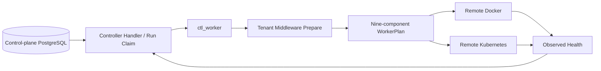

# Controller

[中文](overview_ZH.md) · [Architecture overview](../../overview.md)

**Status:** Current contract and implementation boundary. Source ownership is
`src/controller/`. The platform runs one `CentralController` provider; legacy
Deployer, Factory, and Standalone branches do not exist.

## Responsibility

The platform plane is API, Controller, and Web. API owns CRUD for tenant
business bindings, Workflows, workers, and connections. Controller owns the
startup, update, shutdown, and health recovery lifecycle of nine tenant data
plane components.

The data plane is Backtest, Datafeed, Evaluator, Strategy, Logservice,
Exporter, Notifier, Order, and Wallet. Each Workflow node is an isolated
component instance that asynchronously pub/subs through tenant/Workflow MQTT
topics. Exchange and Messager are embedded shared libraries, not deployments.

## Reconciliation

Each pass:

1. Locks one active Workflow and its existing `run_id` by
   `env/tenant_id/workflow_id`.
2. Fixes or reuses `wf_run.worker_id`, preferring a Workflow-specific worker
   and then a shared worker of the same tenant.
3. Idempotently prepares configured Redis, pgvector, TimescaleDB, and EMQX on
   that worker.
4. Builds the nine node plan kinds from the durable Workflow snapshot only
   after middleware is ready.
5. Starts Backtest/Wallet/Order/Strategy/Evaluator/auxiliary consumers/Datafeed
   in subscriber-first order.
6. Docker uses named containers and volumes. Kubernetes uses Deployments,
   Services, NetworkPolicies, and required PVCs. An unchanged specification
   hash does not replace an instance.
7. Writes observed ready/restarted state to the same run. Restarts retain
   `run_id` and increment attempt_no.

## Tenant Middleware

`ctl_worker.middleware` allows only `image` and
`resources {cpu_millis,memory_mb,storage_gb}` for four middleware kinds. It
does not accept arbitrary PodSpecs, privileges, hostPath, host networking, or
command overrides. One typed configuration supplies defaults; Web form and
YAML modes call the same API and receive the same server validation.

Redis is a six-node cluster (three masters and three replicas). pgvector,
TimescaleDB, and EMQX currently use one stateful instance each. Every resource
has a stable `worker-target` ownership label. Disabling a middleware stops its
workload but retains PVCs/volumes for recovery. Stopping one Workflow never
deletes worker/tenant middleware.

Endpoints are injected only after worker selection. EMQX updates the node's
Messager argument; other endpoints use the central `SIGBOT__...` configuration
layer. Credential values exist only in a remote Kubernetes runtime Secret or
an owner-only Docker host env-file. `ctl_worker` stores Secret key references.

## Provider SPI

| Layer | Contract / implementation | Responsibility |
|---|---|---|
| Service root | `IController` / `CentralController` | Scheduler and process lifecycle |
| Router | `WorkerRouter` | Select adapter from `ctl_worker.provider` |
| Runtime provider | `WorkerProvider` | Idempotent `prepare/apply/remove` |
| Adapter | `DockerController` | Remote containers, volumes, and health |
| Adapter | `KubernetesController` | Remote workloads, services, policies, and health |

## Invariants

- Authguard solely owns users, identities, memberships, roles, and permissions.
  Controller has no global user context.
- PostgreSQL row locking and a fixed `worker_id` prevent duplicate owners;
  retries never silently move a run.
- Controller mutates only resources whose managed-by, worker-target, and
  domain ownership labels all match.
- Secrets never enter database payloads, plans, status, labels, or logs.
- One Strategy decision instance has one owner. Ordinary Python is not
  automatically parallelized by scaling.
- Stop, repeated reconciliation, process restart, and out-of-order status
  updates are idempotent.

## Source Map

- Provider and scheduler: `src/controller/src/{controller.rs,worker/}`
- Docker/Kubernetes adapters: `src/controller/src/{docker,kubernetes}/`
- Worker handler/repository: `src/core/src/modules/controller/`
- Worker API: `src/api/http/src/worker.rs`
- Platform Helm: `deploy/helm/sigbot/templates/{api,controller,middleware,web}/`
