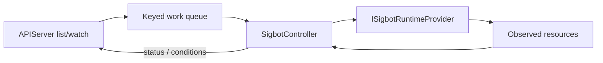

# Controller

[中文](overview_ZH.md) · [Architecture overview](../../overview.md)

**Status:** Normative target architecture. The current physical source owner is
`src/deployer/`; its observed behavior is described separately below.

`SigbotController` reconciles the fixed `StrategyPipeline` resource. It borrows
the Kubernetes controller pattern—desired state, observed state, idempotent
reconciliation, and status conditions—without turning SigBot into a general
DAG scheduler.

## StrategyPipeline Resource

```text
StrategyPipelineSpec
  tenant_id
  pipeline_id
  feed_bindings[]
  evaluator
  strategy
  execution { wallet_id, exchange_ref, risk_policy }
  notification_channels[]
  export_sinks[]
  desired_state
```

The shape is finite. A pipeline always evaluates market context, runs one
deterministic strategy, and routes actionable signals through Order Manager.
Optional delivery features may be disabled, but arbitrary node types and edges
are not accepted.

## Reconciliation Loop



For each `{tenant_id, pipeline_id}` key, the controller:

1. Reads the latest desired specification from APIServer.
2. Compares its generation with observed runtime resources.
3. Ensures one logical Datafeed binding, one strategy-scoped Evaluator worker
   set, and one strategy-scoped Strategy Runner worker set.
4. Applies stable owner labels, configuration hashes, resource limits, and
   secret references through the selected runtime provider.
5. Removes only resources owned by that pipeline when it is disabled or
   deleted.
6. Writes `observed_generation`, endpoint references, and typed conditions
   through the APIServer status API.

Watch drives low-latency updates; periodic full list/reconciliation recovers
lost events. Work is keyed and coalesced so repeated events do not create
duplicate workloads.

## Deployment Scope

| Resource | Controller action |
|---|---|
| Datafeed | Create/release a logical `DatafeedBinding`; do not create a duplicate shared daemon or public upstream connection |
| Evaluator | Reconcile a strategy-scoped worker set and its distinct consumer group |
| Strategy Runner | Reconcile a strategy-scoped worker set and its distinct consumer group |
| Order, Wallet, Notifier, Exporter | Reference shared service endpoints and per-pipeline configuration; do not create a copy per strategy |
| Backtest | Create a run-scoped job only for an accepted backtest request |
| Middleware | Treat cluster infrastructure as platform provisioning, not as a child of every strategy pipeline |

Public feed workers can be shared across tenants. Private account feeds require
credential- and entitlement-scoped isolation; this rule is owned by
[Datafeed](../datafeed/overview.md).

## Extension Points

| Role | Contract | Implementations |
|---|---|---|
| Service root | `SigbotController` | Fixed pipeline reconciliation process |
| Reconciliation policy | `ISigbotPipelineController` | `SigbotDefaultPipelineController` |
| Runtime projection | `ISigbotRuntimeProvider` | `SigbotKubernetesRuntimeProvider`, `SigbotDockerRuntimeProvider`, `SigbotStandaloneRuntimeProvider` |

Runtime providers translate a provider-neutral desired resource into platform
objects. They do not query business tables or redefine pipeline semantics.

## Invariants

- Controller never connects to the core, Order, or Wallet databases.
- Reconciliation is idempotent and safe after crash, duplicate watch event, or
  leader change.
- Multiple replicas shard by stable pipeline key or use leases; at most one
  replica actively mutates one pipeline at a time.
- Deletion is owner-scoped. A failed or stale controller cannot delete shared
  infrastructure or another pipeline's resources.
- Secrets are referenced, not copied into status, labels, logs, or ordinary
  environment snapshots.
- Status reports observed facts; it never rewrites desired configuration.

## Implementation Alignment

Current `src/deployer/` exposes `SigbotDeployerFactory`, `ISigbotDeployer`, and
Kubernetes, Docker, and standalone implementations. It scans tenants directly
through `SigbotState`, deploys a tenant-oriented subset of middleware and
services, and has incomplete standalone behavior.

Required alignment is strategy-pipeline granularity, APIServer list/watch and
status access, shared-daemon references, logical Datafeed bindings, complete
Evaluator/Strategy runtime ownership, and the `SigbotController` public
contract. No general workflow-node scheduler belongs in this component.

## Source Map

- Current runtime provider implementations: `src/deployer/`
- Target resource APIs and repositories: `src/core/`
- Kubernetes and Docker deployment assets: `tooling/deploy/`
