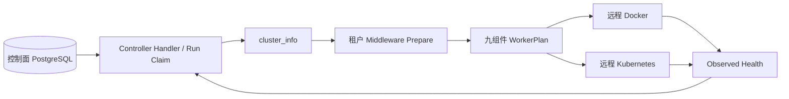

# Controller

[English](overview.md) · [架构总览](../../overview_ZH.md)

**状态：** 当前规范和实现边界。物理源码归属 `src/controller/`；平台面只运行一个
`CentralController` Provider，不再保留 Deployer、Factory 或 Standalone 分支。

## 职责

平台面核心服务是 API、Controller、Web：API 负责租户业务绑定、Workflow、Worker
和连接等配置 CRUD；Controller 负责租户级九个组件的启动、更新、停止与健康恢复。

数据面九个组件是 Backtest、Datafeed、Evaluator、Strategy、Logger、Exporter、
Notifier、Order、Wallet。它们按 Workflow Node 实例部署，通过租户/Workflow 隔离的
MQTT Topic 异步 pub/sub；Exchange 与 Messager 是组件内共享库，不独立部署。

## Reconciliation

每轮协调执行：

1. 按 `env/tenant_id/workflow_id` 锁定一个 active Workflow 和既有 `run_id`。
2. 固定或复用 `wf_run.cluster_id`；先选 Workflow 专属 Worker，再选同租户共享 Worker。
3. 在该 Worker 上幂等准备配置的 Redis、pgvector、TimescaleDB、EMQX。
4. 中间件全部就绪后，从持久化 Workflow Snapshot 生成九类 Node `WorkerPlan`。
5. 按 Backtest/Wallet/Order/Strategy/Evaluator/辅助消费者/Datafeed 顺序启动，保证订阅者
   先于生产者建立持久订阅。
6. Docker 使用具名 Container/Volume；Kubernetes 使用 Deployment、Service、
   NetworkPolicy 和必要的 PVC。配置哈希不变时不替换实例。
7. 把 observed ready/restarted 写回同一 Run；重启保持 `run_id` 并递增 attempt_no。

## 租户中间件

`cluster_info.middleware` 只允许四种中间件各自的 `image` 与
`resources {cpu_millis,memory_mb,storage_gb}`；不接受任意 PodSpec、特权、hostPath、
宿主网络或命令覆盖。默认值由单一 typed configuration 提供，Web 的表单/YAML 模式
都调用同一个 API 并接受相同服务端校验。

Redis 固定为六节点 Cluster（三主三从）；pgvector、TimescaleDB、EMQX 当前各一个
Stateful 实例。所有对象带稳定 `worker-target` ownership label。禁用某项会停止其工作负载，
但 PVC/Volume 保留以便恢复；停止单个 Workflow 不删除 Worker/租户级中间件。

组件端点只在 Worker 选定后注入：EMQX 写入节点 Messager 参数，其余通过统一
`SIGBOT__...` 配置层覆盖。凭据正文仅存在于远程 Kubernetes runtime Secret 或 Docker
宿主 owner-only env-file；`cluster_info` 只保存 Secret key 引用。

## Provider SPI

| 层 | 契约/实现 | 职责 |
|---|---|---|
| Service Root | `IController` / `CentralController` | Scheduler 与统一生命周期 |
| Router | `WorkerRouter` | 按 `cluster_info.provider` 选择执行适配器 |
| Runtime Provider | `WorkerProvider` | `prepare/apply/remove` 幂等契约 |
| Adapter | `DockerController` | 远程 Docker Container、Volume、health |
| Adapter | `KubernetesController` | 远程 K8s Workload、Service、Policy、health |

## 不变量

- Authguard 是用户、身份、成员、角色和权限的唯一来源；Controller 不维护全局用户上下文。
- Run claim 的 PostgreSQL 行锁和固定 `cluster_id` 防止重复 owner；重试不得偷偷迁移 Worker。
- Controller 只能修改同时匹配 managed-by、worker-target 和领域 owner label 的资源。
- Secret 不进入数据库正文、Plan、Status、Label 或日志；运行时只传引用和必要的进程环境。
- 同一 Strategy 决策实例始终单 owner；普通 Python 不因扩容自动并行。
- 停止、重复 reconcile、进程重启与乱序状态更新必须幂等。

## 源码地图

- Provider 与 Scheduler：`src/controller/src/{controller.rs,worker/}`
- Docker/Kubernetes Adapter：`src/controller/src/{docker,kubernetes}/`
- Worker Handler/Repository：`src/core/src/modules/controller/`
- Cluster CRUD API：`src/api/http/src/cluster/cluster.rs`
- Helm 平台面：`deploy/helm/sigbot/templates/{api,controller,middleware,web}/`
