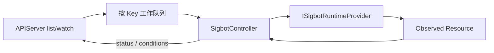

# Controller

[English](overview.md) · [架构总览](../../overview_ZH.md)

**状态：** 规范性目标架构。当前物理源码归属是 `src/deployer/`，其已有行为在下文
单独说明。

`SigbotController` Reconcile 固定 `StrategyPipeline` Resource。它借鉴 Kubernetes
Controller 的 Desired State、Observed State、幂等 Reconciliation 与 Status
Condition，但不会把 SigBot 变成通用 DAG Scheduler。

## StrategyPipeline Resource

```text
StrategyPipelineSpec
  tenant_id
  pipeline_id
  feed_bindings[]
  evaluator
  strategy
  execution { wallet_id, exchange_ref, risk_policy }
  notification_channels[]
  export_sinks[]
  desired_state
```

该结构是有限的：Pipeline 始终评估市场上下文、运行一个确定性策略，并把可执行
Signal 交给 Order Manager。可选投递能力可以关闭，但不接受任意 Node 类型与 Edge。

## Reconciliation Loop



对于每个 `{tenant_id, pipeline_id}` Key，Controller：

1. 从 APIServer 读取最新 Desired Spec。
2. 比较 Spec Generation 与 Observed Runtime Resource。
3. 确保一个逻辑 Datafeed Binding、一组 Strategy-scoped Evaluator Worker 和一组
   Strategy-scoped Strategy Runner Worker。
4. 通过选定 Runtime Provider 应用稳定 Owner Label、Configuration Hash、Resource
   Limit 与 Secret Reference。
5. Pipeline 禁用或删除时，只回收由该 Pipeline 拥有的 Resource。
6. 通过 APIServer Status API 写入 `observed_generation`、Endpoint Reference 和类型化
   Condition。

Watch 负责低延迟更新；周期性完整 List/Reconcile 用于恢复丢失事件。工作按 Key
合并，重复事件不会创建重复 Workload。

## 部署作用域

| Resource | Controller 动作 |
|---|---|
| Datafeed | 创建/释放逻辑 `DatafeedBinding`；不得重复创建共享 daemon 或公共上游连接 |
| Evaluator | Reconcile Strategy-scoped Worker Set 及独立 Consumer Group |
| Strategy Runner | Reconcile Strategy-scoped Worker Set 及独立 Consumer Group |
| Order、Wallet、Notifier、Exporter | 引用共享 Service Endpoint 与 Pipeline 配置；不得每策略复制一套 |
| Backtest | 仅为已接受 Backtest Request 创建 Run-scoped Job |
| Middleware | 作为平台基础设施 Provisioning，不作为每个 Strategy Pipeline 的 Child |

公共 Feed Worker 可以跨 Tenant 复用；私有账户 Feed 必须按 Credential 与 Entitlement
Scope 隔离。该规则由 [Datafeed](../datafeed/overview_ZH.md)拥有。

## 扩展点

| 角色 | 契约 | 实现 |
|---|---|---|
| Service Root | `SigbotController` | 固定 Pipeline Reconciliation 进程 |
| Reconciliation Policy | `ISigbotPipelineController` | `SigbotDefaultPipelineController` |
| Runtime Projection | `ISigbotRuntimeProvider` | `SigbotKubernetesRuntimeProvider`、`SigbotDockerRuntimeProvider`、`SigbotStandaloneRuntimeProvider` |

Runtime Provider 把 Provider-neutral Desired Resource 翻译成平台对象，不能查询业务表
或重新定义 Pipeline 语义。

## 不变量

- Controller 禁止连接核心、Order 或 Wallet 数据库。
- Reconciliation 在 Crash、重复 Watch Event 或 Leader 切换后仍幂等安全。
- 多 Replica 按稳定 Pipeline Key 分片或使用 Lease；同一时刻最多一个 Replica 主动
  修改一个 Pipeline。
- 删除必须受 Owner Scope 约束；失效 Controller 不能删除共享基础设施或其他
  Pipeline 的 Resource。
- Secret 只通过 Reference 使用，禁止复制到 Status、Label、Log 或普通 Environment
  Snapshot。
- Status 只报告 Observed Fact，不能重写 Desired Configuration。

## 实现对齐

当前 `src/deployer/` 暴露 `SigbotDeployerFactory`、`ISigbotDeployer` 及 Kubernetes、
Docker、Standalone 实现。它通过 `SigbotState` 直接扫描 Tenant，部署面向 Tenant 的
部分 Middleware/Service，Standalone 行为也尚不完整。

必须对齐到 Strategy Pipeline 粒度、APIServer List/Watch/Status、共享 daemon
Reference、逻辑 Datafeed Binding、完整 Evaluator/Strategy Runtime Ownership，以及
`SigbotController` 公开契约。本组件不拥有通用 Workflow Node Scheduler。

## 源码地图

- 当前 Runtime Provider 实现：`src/deployer/`
- 目标 Resource API 与 Repository：`src/core/`
- Kubernetes 与 Docker 部署资产：`tooling/deploy/`
