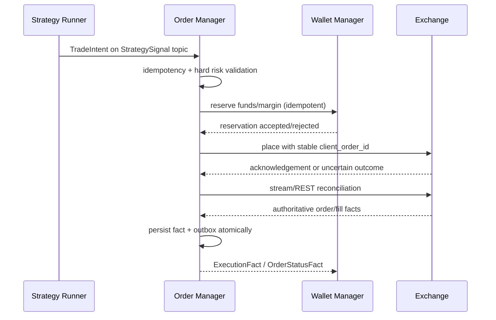

# Order Manager

[中文](overview_ZH.md) · [Architecture overview](../../overview.md)

**Status:** Implemented reservation-first execution and reconciliation path;
real-money and genuine cross-venue acceptance remain external gaps.

`SigbotOrderServer` is the only service allowed to invoke private trading
capabilities on an exchange. It consumes actionable strategy intents, performs
authoritative risk and account checks, owns the order/fill state machine,
reconciles uncertain venue outcomes, and publishes immutable execution facts.

## Execution Flow

A placement acknowledgement is not a fill. Unknown timeouts are reconciled by
stable client order ID before a retry can create another external order.
Permanent validation/rejection errors are not blindly retried.

## Owned State and Events

The `ord_*` table domain has one Order Repository writer and contains:

- accepted `TradeIntent` records and idempotency keys;
- orders and valid state transitions;
- execution attempts and external request/response references;
- immutable fills, fees, funding, settlement, cancellation, rejection, and
  liquidation facts received from the venue;
- reconciliation cursors and transactional outbox entries.

Durable execution messages preserve the envelope scope, source node, run and
sequence together with account, wallet, venue, client/exchange order, trade,
instrument, price, quantity, fee and event time. Order receipts/status and
money-changing `ExecutionFact` payloads are distinct contracts.

Wallet consumes only authoritative monetary facts. Exporter may consume the
complete approved execution stream. Notifier receives typed operational events,
not raw exchange payloads.

## Extension Points

| Role | Contract | Examples |
|---|---|---|
| Service root | `SigbotOrderServer` | Component startup and Provider registration |
| Order policy | `IOrder` | `WorkflowOrderProcessor` |
| Hard risk | `RiskPolicy` | Account, position, exposure, price, and rate policies |
| Venue access | `IExchange` | Capability-aware venue adapters |
| Persistence | Core Handler/Repository | `OrderPostgresRepository`, `OrderSQLiteRepository` |

`RiskPolicy` is an independently testable component, but Order owns
the final allow/deny decision. Strategy suggestions cannot bypass it.

## Consistency Boundary

- Accepting an intent, advancing local order state, and writing an outbox event
  occur in one Order transaction when they are part of one transition.
- Wallet funds/margin reservation uses an idempotent service contract; it does
  not grant Order access to Wallet tables.
- The current final-state migration stores `ord_*` and `wlt_*` in one physical
  schema, but their Core repositories and write ownership remain separate.
- Cross-service consistency is recoverable and auditable through outbox/inbox,
  retry, replay, and exchange reconciliation.
- Requiring one local ACID transaction across orders and portfolio accounting
  means they must become one physical bounded context. Two daemons must not
  share writable tables as a shortcut.

## Safety Invariants

- Deduplicate by durable scope, producer node, `run_id`, and sequence before any
  external side effect.
- Use a stable venue-supported client order ID for every placement attempt.
- Serialize conflicting transitions for one order/account while allowing
  unrelated work to proceed concurrently.
- Validate instrument rules, price/quantity precision, account permissions,
  available reservation, exposure, and stale market guards immediately before
  placement.
- Do not hold a database lock or transaction open across an exchange network
  call.
- Credentials remain in the exchange adapter security boundary and are never
  carried in intents or execution events.

## Implementation Alignment

`SigbotOrderServer` validates scoped intents and persisted market evidence,
balances/positions, instrument precision, execution mode, and hard risk before
requesting a Wallet reservation. It durably prepares live submissions, treats
placement ACK separately from fills, preserves unknown outcomes for venue
reconciliation, and commits order/execution observations with Outbox state.
Execution groups wait for authoritative leg and Wallet outcomes before issuing
reduce-only compensation through the same path.

The accepted evidence covers Paper/Backtest and SDK/RPC boundary fixtures, not
real-money settlement, exchange-wide cancellation races, or genuine cross-
venue compensation.

## Source Map

- Order component: `src/component/order/`
- Order repositories: `src/core/src/modules/order/storage/`
- Exchange clients: `src/exchange/`
- Order and trade event types: `src/types/src/order/`
