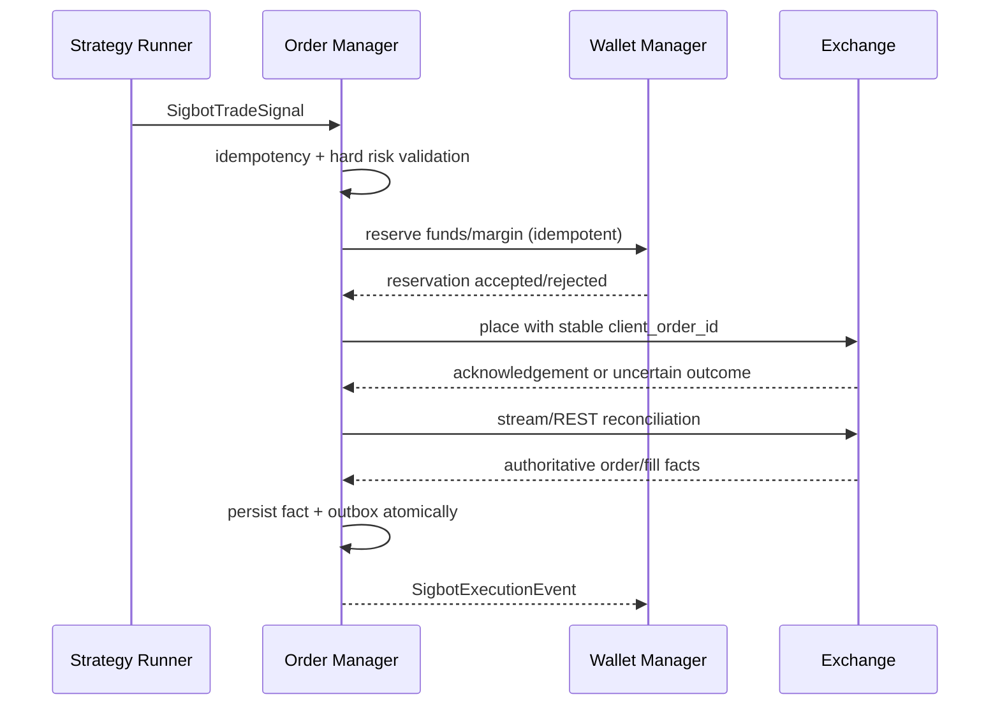

# Order Manager

[中文](overview_ZH.md) · [Architecture overview](../../overview.md)

**Status:** Normative target architecture with an incomplete execution path.

`SigbotOrderManager` is the only service allowed to invoke private trading
capabilities on an exchange. It consumes actionable strategy signals, performs
authoritative risk and account checks, owns the order/fill state machine,
reconciles uncertain venue outcomes, and publishes immutable execution facts.

## Execution Flow

A placement acknowledgement is not a fill. Unknown timeouts are reconciled by
stable client order ID before a retry can create another external order.
Permanent validation/rejection errors are not blindly retried.

## Owned State and Events

The Order database or schema is private to this service and contains:

- accepted strategy intents and idempotency keys;
- orders and valid state transitions;
- execution attempts and external request/response references;
- immutable fills, fees, funding, settlement, cancellation, rejection, and
  liquidation facts received from the venue;
- reconciliation cursors and transactional outbox entries.

`SigbotExecutionEvent` preserves tenant, pipeline, strategy, signal, account,
venue, client/exchange order, and fill identifiers plus causation and schema
versions. Business variants distinguish order acceptance/rejection/update from
money-changing facts such as `TradeFilled`, `FeeCharged`, `FundingApplied`, and
`LiquidationExecuted`.

Wallet consumes only authoritative monetary facts. Exporter may consume the
complete approved execution stream. Notifier receives typed operational events,
not raw exchange payloads.

## Extension Points

| Role | Contract | Examples |
|---|---|---|
| Service root | `SigbotOrderManager` | `SigbotEventDrivenOrderManager` |
| Order policy | `ISigbotOrderManager` | Signal-to-order orchestration |
| Hard risk | `ISigbotRiskPolicy` | Account, position, exposure, price, and rate policies |
| Venue access | `ISigbotExchangeClient` | Capability-aware venue adapters |
| Persistence | `ISigbotOrderRepository` | `SigbotPostgresOrderRepository` |

Risk validation is an independently testable port, but the Order Manager owns
the final allow/deny decision. Strategy suggestions cannot bypass it.

## Consistency Boundary

- Accepting a signal, advancing local order state, and writing an outbox event
  occur in one Order transaction when they are part of one transition.
- Wallet funds/margin reservation uses an idempotent service contract; it does
  not grant Order access to Wallet tables.
- Order and Wallet may share a PostgreSQL cluster, but use separate databases
  or schemas, roles, migrations, and write ownership.
- Cross-service consistency is recoverable and auditable through outbox/inbox,
  retry, replay, and exchange reconciliation.
- Requiring one local ACID transaction across orders and portfolio accounting
  means they must become one physical bounded context. Two daemons must not
  share writable tables as a shortcut.

## Safety Invariants

- Deduplicate by signal ID before any external side effect.
- Use a stable venue-supported client order ID for every placement attempt.
- Serialize conflicting transitions for one order/account while allowing
  unrelated work to proceed concurrently.
- Validate instrument rules, price/quantity precision, account permissions,
  available reservation, exposure, and stale market guards immediately before
  placement.
- Do not hold a database lock or transaction open across an exchange network
  call.
- Credentials remain in the exchange adapter security boundary and are never
  carried in signals or execution events.

## Implementation Alignment

Current source exposes `SigbotOrderServer`, `ISigbotOrderManager`, and
`SigbotDefaultOrderManager`. It subscribes to a trade-signal topic, but the
exchange registry is not populated, risk checks and retries are skeletal, and
there is no durable order/fill state machine, dedicated Order database,
idempotency record, reconciliation loop, or transactional outbox. The current
event is synthesized from a placement result and does not represent a complete
authoritative fill.

Required alignment is the `SigbotOrderManager` root, durable state and outbox,
stable external idempotency, Wallet reservation, venue reconciliation, and
typed execution facts.

## Source Map

- Order service: `src/order/`
- Exchange clients: `src/exchange/`
- Order and trade event types: `src/types/src/modules/`
