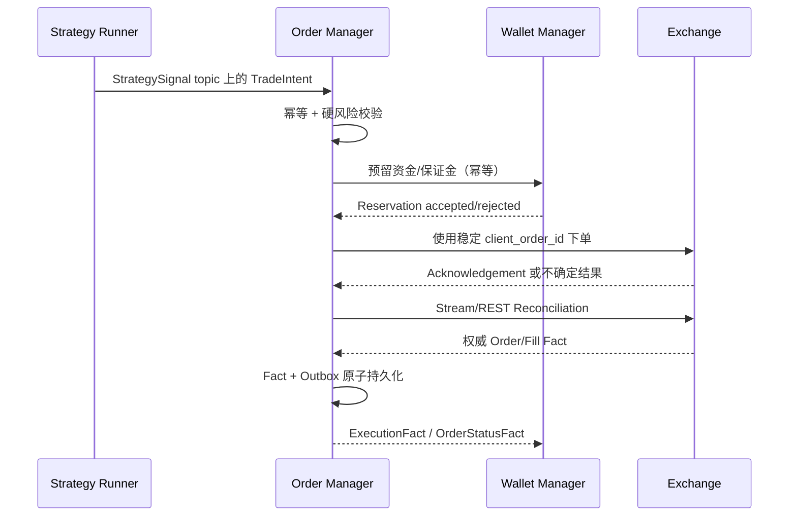

# Order Manager

[English](overview.md) · [架构总览](../../overview_ZH.md)

**状态：** 已实现预占先行的执行与对账链路；实盘资金和真实跨所验收仍是外部缺口。

`SigbotOrderServer` 是唯一允许调用 Exchange 私有交易能力的服务。它消费可执行
`TradeIntent`，执行权威 Risk/Account 校验，拥有 Order/Fill 状态机，对账交易所
不确定结果，并发布不可变 Execution Fact。

## 执行流程

Placement Acknowledgement 不是 Fill。发生未知 Timeout 时，必须先按稳定 Client Order
ID 对账，才能重试，避免创建重复外部订单。永久 Validation/Rejection Error 不能盲目
Retry。

## 所有状态与事件

`ord_*` 表领域只有 Order Repository 一个写入方，保存：

- 已接受 Strategy Intent 与 Idempotency Key；
- Order 及其合法 State Transition；
- Execution Attempt 与外部 Request/Response Reference；
- 从 Venue 得到的不可变 Fill、Fee、Funding、Settlement、Cancellation、Rejection 与
  Liquidation Fact；
- Reconciliation Cursor 与 Transactional Outbox Entry。

持久 Execution 消息保留 Envelope scope、源节点、Run、序列以及 Account、Wallet、
Venue、Client/Exchange Order、Trade、Instrument、Price、Quantity、Fee 和事件时间。
Order Receipt/Status 与改变资金的 `ExecutionFact` 是不同契约。

Wallet 只消费权威资金事实；Exporter 可以消费完整且已批准的 Execution Stream；
Notifier 接收类型化 Operational Event，而不是原始 Exchange Payload。

## 扩展点

| 角色 | 契约 | 示例 |
|---|---|---|
| Service Root | `SigbotOrderServer` | 组件启动与 Provider 注册 |
| Order Policy | `IOrder` | `WorkflowOrderProcessor` |
| 硬风险 | `RiskPolicy` | Account、Position、Exposure、Price 与 Rate Policy |
| Venue Access | `IExchange` | 感知 Capability 的 Venue Adapter |
| Persistence | Core Handler/Repository | `OrderPostgresRepository`、`OrderSQLiteRepository` |

`RiskPolicy` 是可独立测试的组件，但最终 Allow/Deny 由 Order 拥有，
Strategy 建议不能绕过。

## 一致性边界

- 接受 Intent、推进本地 Order State、写 Outbox 属于同一 Transition 时，必须在一个
  Order Transaction 中完成。
- Wallet 资金/保证金 Reservation 使用幂等 Service Contract，不授予 Order 访问
  Wallet Table 的权限。
- 当前最终态迁移把 `ord_*` 与 `wlt_*` 放在同一个物理 Schema，但两者的 Core
  Repository 与写所有权必须独立。
- 跨服务通过 Outbox/Inbox、Retry、Replay 与 Exchange Reconciliation 达成可恢复、
  可审计一致性。
- 如果 Order 与 Portfolio Accounting 必须在一个本地 ACID Transaction 内，则应
  成为一个物理 Bounded Context；禁止两个 daemon 通过共享可写表走捷径。

## 安全不变量

- 任何外部副作用发生前，必须按持久 scope、producer node、`run_id` 与 seq 去重。
- 每个 Placement Attempt 使用 Venue 支持的稳定 Client Order ID。
- 同一 Order/Account 的冲突 Transition 串行化，无关工作可以并发。
- 下单前立即校验 Instrument Rule、Price/Quantity Precision、Account Permission、
  可用 Reservation、Exposure 与 Stale-market Guard。
- Exchange Network Call 期间禁止持有数据库 Lock 或 Transaction。
- Credential 留在 Exchange Adapter 安全边界内，禁止进入 Intent 或 Execution Event。

## 实现对齐

`SigbotOrderServer` 已校验作用域 Intent、持久行情证据、余额/仓位、Instrument 精度、
执行模式和硬风控，再请求 Wallet 预占。Live Submission 先持久准备；Placement ACK 与
Fill 分离；未知结果保留并进入 Venue 对账；Order/Execution Observation 与 Outbox 同事务
提交。Execution Group 等待权威 Leg 与 Wallet 结果后，再通过同一路径发出 reduce-only 补偿。

现有验收覆盖 Paper/Backtest 和 SDK/RPC 边界夹具，不代表实盘结算、全交易所撤单竞态
或真实跨所补偿。

## 源码地图

- Order 数据面组件：`src/component/order/`
- Order Repository：`src/core/src/modules/order/storage/`
- Exchange Client：`src/exchange/`
- Order 与 Trade Event 类型：`src/types/src/order/`
