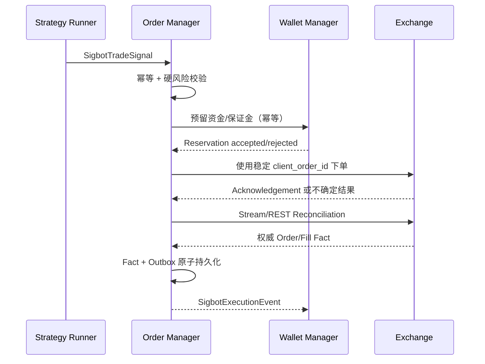

# Order Manager

[English](overview.md) · [架构总览](../../overview_ZH.md)

**状态：** 规范性目标架构；当前执行链路尚不完整。

`SigbotOrderManager` 是唯一允许调用 Exchange 私有交易能力的服务。它消费可执行
Strategy Signal，执行权威 Risk/Account 校验，拥有 Order/Fill 状态机，对账交易所
不确定结果，并发布不可变 Execution Fact。

## 执行流程

Placement Acknowledgement 不是 Fill。发生未知 Timeout 时，必须先按稳定 Client Order
ID 对账，才能重试，避免创建重复外部订单。永久 Validation/Rejection Error 不能盲目
Retry。

## 所有状态与事件

Order Database/Schema 由本服务私有拥有，保存：

- 已接受 Strategy Intent 与 Idempotency Key；
- Order 及其合法 State Transition；
- Execution Attempt 与外部 Request/Response Reference；
- 从 Venue 得到的不可变 Fill、Fee、Funding、Settlement、Cancellation、Rejection 与
  Liquidation Fact；
- Reconciliation Cursor 与 Transactional Outbox Entry。

`SigbotExecutionEvent` 保留 Tenant、Pipeline、Strategy、Signal、Account、Venue、
Client/Exchange Order、Fill 标识及 Causation/Schema Version。业务 Variant 必须区分
Order Accepted/Rejected/Updated 与 `TradeFilled`、`FeeCharged`、`FundingApplied`、
`LiquidationExecuted` 等资金变化事实。

Wallet 只消费权威资金事实；Exporter 可以消费完整且已批准的 Execution Stream；
Notifier 接收类型化 Operational Event，而不是原始 Exchange Payload。

## 扩展点

| 角色 | 契约 | 示例 |
|---|---|---|
| Service Root | `SigbotOrderManager` | `SigbotEventDrivenOrderManager` |
| Order Policy | `IOrder` | Signal-to-order 编排 |
| 硬风险 | `ISigbotRiskPolicy` | Account、Position、Exposure、Price 与 Rate Policy |
| Venue Access | `IExchange` | 感知 Capability 的 Venue Adapter |
| Persistence | `ISigbotOrderRepository` | `SigbotPostgresOrderRepository` |

Risk Validation 是可独立测试的 Port，但最终 Allow/Deny 由 Order Manager 拥有，
Strategy 建议不能绕过。

## 一致性边界

- 接受 Signal、推进本地 Order State、写 Outbox 属于同一 Transition 时，必须在一个
  Order Transaction 中完成。
- Wallet 资金/保证金 Reservation 使用幂等 Service Contract，不授予 Order 访问
  Wallet Table 的权限。
- Order 与 Wallet 可以共用 PostgreSQL Cluster，但必须使用独立 Database/Schema、
  Role、Migration 与写所有权。
- 跨服务通过 Outbox/Inbox、Retry、Replay 与 Exchange Reconciliation 达成可恢复、
  可审计一致性。
- 如果 Order 与 Portfolio Accounting 必须在一个本地 ACID Transaction 内，则应
  成为一个物理 Bounded Context；禁止两个 daemon 通过共享可写表走捷径。

## 安全不变量

- 任何外部副作用发生前，必须按 Signal ID 去重。
- 每个 Placement Attempt 使用 Venue 支持的稳定 Client Order ID。
- 同一 Order/Account 的冲突 Transition 串行化，无关工作可以并发。
- 下单前立即校验 Instrument Rule、Price/Quantity Precision、Account Permission、
  可用 Reservation、Exposure 与 Stale-market Guard。
- Exchange Network Call 期间禁止持有数据库 Lock 或 Transaction。
- Credential 留在 Exchange Adapter 安全边界内，禁止进入 Signal 或 Execution Event。

## 实现对齐

当前源码暴露 `SigbotOrderServer`、`IOrder` 与
`DefaultOrder`。它已订阅 Trade-signal Topic，但 Exchange Registry
尚未填充，Risk/Retry 仍是骨架；没有持久化 Order/Fill 状态机、专用 Order DB、
Idempotency Record、Reconciliation Loop 或 Transactional Outbox。当前 Event 由
Placement Result 简化生成，不代表完整权威 Fill。

必须对齐到 `SigbotOrderManager` Root、持久化状态与 Outbox、稳定外部幂等、Wallet
Reservation、Venue Reconciliation 与类型化 Execution Fact。

## 源码地图

- Order 数据面组件：`src/component/order/`
- Exchange Client：`src/exchange/`
- Order 与 Trade Event 类型：`src/types/src/`
