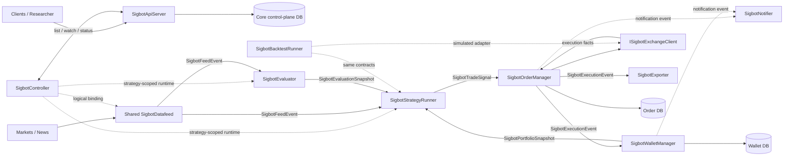

# SigBot Core Architecture

[中文](overview_ZH.md) · [Documentation index](../index.md)

**Status:** Normative target architecture. The implementation-alignment table
separates currently available behavior from required design contracts.

SigBot is an AI-assisted quantitative trading system, not a general-purpose
workflow or DAG platform. Its central design is a constrained
`StrategyPipeline`: a non-deterministic AI side path classifies the current
market structure and recommends bounded hyperparameters, while deterministic
Python strategy code combines that recommendation with market data and the
current portfolio state to make the final trading decision.

The AI never places orders. When the market cannot be classified, confidence
is too low, an evaluation has expired, or a required input is inconsistent,
the deterministic boundary produces `NONE` and opens no new position.

## System Model



The APIServer and Controller form the control plane. Live market evaluation,
strategy decisions, order execution, and portfolio accounting form the trading
data plane. Backtesting composes the same domain contracts with a historical
source, virtual clock, simulated exchange, and run-scoped stores; it is not a
second production topology.

## Decision Contract

The live decision path joins three versioned inputs:

1. `SigbotFeedEvent` and its bounded market window, normalized by Datafeed.
2. The latest non-expired `SigbotEvaluationSnapshot` whose evaluated watermark
   does not look beyond the decision event.
3. A current `SigbotPortfolioSnapshot` owned by Wallet Manager.

`SigbotEvaluationSnapshot` contains at least the market regime
(`RANGING`, `TRENDING_BULLISH`, `TRENDING_BEARISH`, or `UNKNOWN`), confidence,
schema-validated hyperparameter overrides or weights, input watermark, model
and prompt provenance, effective time, and expiry. The evaluator may be
non-deterministic; the snapshot is immutable and auditable.

`SigbotStrategyRunner` validates the snapshot against the strategy's declared
parameter schema and assembles one immutable execution context. For the same
market window, evaluation snapshot, portfolio version, strategy version, and
risk policy, Python strategy execution must produce the same
`SigbotTradeSignal`. `UNKNOWN`, stale or invalid inputs default to `NONE`.
Only actionable signals cross the Order Manager boundary.

## Fixed Strategy Pipeline

```text
DatafeedBinding
  -> Evaluator side path -----------+
  -> Strategy Runner <--------------+ EvaluationSnapshot
       ^
       +------------------------------ PortfolioSnapshot
       -> Order Manager -> Exchange
              -> Wallet Manager
              -> Exporter
              -> Notifier (typed operational events only)
```

`StrategyPipeline` is a fixed product resource, not an arbitrary graph. Its
specification contains feed bindings, evaluator configuration, deterministic
strategy configuration, execution account and venue, risk policy, notification
channels, export targets, and desired state. Optional capabilities can be
disabled, but callers cannot create new node kinds or arbitrary edges.

## Core Services

| Service | Runtime scope | Canonical responsibility | Design |
|---|---|---|---|
| APIServer | Cluster-shared daemon | Sole gateway to the core control-plane database; owns API, authentication, IAM composition, pipeline desired state, watch, and status APIs | [APIServer](engine/apiserver/overview.md) |
| Controller | Cluster-shared daemon | Reconciles fixed `StrategyPipeline` desired state through APIServer; never scans the core database directly | [Controller](engine/controller/overview.md) |
| Datafeed | Cluster-shared daemon | Shares public upstream market/news connections, normalizes events, and manages pipeline-scoped logical bindings | [Datafeed](engine/datafeed/overview.md) |
| Evaluator | Strategy-scoped worker set | Non-deterministically classifies market structure and publishes bounded, versioned evaluation snapshots | [Evaluator](engine/evaluator/overview.md) |
| Strategy Runner | Strategy-scoped worker set | Deterministically joins feed, evaluation, and portfolio inputs and emits the final signal | [Strategy Runner](engine/strategy-runner/overview.md) |
| Order Manager | Cluster-shared daemon, shardable | Owns order and fill facts, hard risk checks, exchange side effects, reconciliation, and the Order DB | [Order Manager](engine/order-manager/overview.md) |
| Wallet Manager | Cluster-shared daemon, shardable | Owns reservations, immutable ledger, balances, positions, portfolio snapshots, and the Wallet DB | [Wallet Manager](engine/wallet-manager/overview.md) |
| Backtest | Run-scoped job | Replays normalized history through the same decision contracts with virtual time and a simulated exchange | [Backtest](engine/backtest/overview.md) |
| Notifier | Cluster-shared daemon | Routes typed notifications through user-configured delivery channels | [Notifier](engine/notifier/overview.md) |
| Exporter | Cluster-shared daemon | Delivers execution facts to user-configured downstream sinks | [Exporter](engine/exporter/overview.md) |
| Log Service | Cluster-shared daemon | Streams and archives operational logs without joining the trading decision path | [Log Service](engine/log-service/overview.md) |

Tenant, user, identity, membership, role, permission, policy, and logical
namespace semantics have one canonical owner:
[Tenant Governance & IAM](engine/apiserver/tenant-governance-and-iam.md).

## Embedded Components and Protocol Adapters

These components are composed into services; they do not own a step in the
fixed trading pipeline.

| Component | Responsibility | Design |
|---|---|---|
| Exchange | Unified async trading, account, market-data, and stream capabilities for venues such as Binance, Bitget, Coinbase, IBKR, Schwab, and the simulated venue | [Exchange](engine/exchange/overview.md) |
| Messager | Transport-neutral async event SDK: local queue in all-in-one mode and MQTT/EMQX in distributed mode | [Messager](engine/messager/overview.md) |
| A2A | Optional external agent interoperability; it cannot bypass pipeline policy or place orders directly | [A2A](engine/a2a/overview.md) |
| MCP | Optional tool protocol for API exposure and evaluator context; it is not the canonical live market feed | [MCP](engine/mcp/overview.md) |

## Naming and Extension Rules

- Public service roots and startup types use `Sigbot<Component>`.
- Replaceable ports use `ISigbot<Capability>`.
- Concrete adapters use `Sigbot<Provider><Capability>`.
- `Provider` denotes a factory-selected implementation family. Delivery media
  are `NotificationChannel`; export destinations are `ExportSink`.
- Rust acronyms use PascalCase words: `Api`, `Http`, `Mqtt`, `Qq`, `Ibkr`.
- Interfaces belong at actual variation boundaries; avoid a one-to-one trait
  that only mirrors a startup shell.

| Module | Service root | Primary extension ports |
|---|---|---|
| APIServer | `SigbotApiServer` | `ISigbotApiTransport`, `ISigbotCoreRepository` |
| Controller | `SigbotController` | `ISigbotPipelineController`, `ISigbotRuntimeProvider` |
| Datafeed | `SigbotDatafeed` | `ISigbotDatafeedSource` |
| Backtest | `SigbotBacktestRunner` | `ISigbotBacktestEngine`, `ISigbotClock` |
| Evaluator | `SigbotEvaluator` | `ISigbotMarketEvaluator` |
| Strategy Runner | `SigbotStrategyRunner` | `ISigbotStrategyExecutor` |
| Order Manager | `SigbotOrderManager` | `ISigbotOrderManager`, `ISigbotRiskPolicy` |
| Wallet Manager | `SigbotWalletManager` | `ISigbotWalletManager`, `ISigbotPortfolioLedger` |
| Notifier | `SigbotNotifier` | `ISigbotNotifier`, `ISigbotNotificationChannel` |
| Exporter | `SigbotExporter` | `ISigbotExporter`, `ISigbotExportSink` |
| Exchange SDK | Composed, no daemon | `ISigbotExchangeClient`, capability-specific subports |
| Messager SDK | Composed, no daemon | `ISigbotMessagerClient` |

## Data Ownership and Consistency

- APIServer is the only client of the core control-plane database. Controller,
  Evaluator, Strategy Runner, and other engines use APIServer APIs, watches,
  configuration snapshots, or events.
- Order Manager exclusively writes its Order database or schema. Wallet Manager
  exclusively writes its Wallet database or schema. They may share a physical
  PostgreSQL cluster for operations, but never credentials, tables, or write
  ownership.
- Order persists order/execution facts and a transactional outbox atomically.
  Wallet applies each monetary execution fact through an inbox and updates its
  ledger, balance, position, and outbox in one local transaction.
- Cross-service state is recoverable eventual consistency with idempotency,
  replay, and exchange reconciliation. An external venue cannot participate in
  a PostgreSQL transaction.
- If order and portfolio state truly require one ACID transaction, they must be
  one physical bounded-context service. Two daemons sharing tables is not a
  strong-consistency design.
- Specialized market-history and observability stores are not the core
  control-plane database and remain private to their owning component.

## Messaging Invariants

- A published topic never contains MQTT's `$share` prefix. `$share` is a
  subscription filter concern.
- Evaluator and Strategy Runner use different consumer groups for the same
  feed. Replicas of one component share a group; different component roles do
  not, otherwise they would divide events instead of each receiving them.
- Business-event ownership follows the producer: Datafeed owns feed events,
  Evaluator owns evaluation snapshots, Strategy Runner owns signals, Order owns
  execution facts, and Wallet owns portfolio snapshots. Messager owns only the
  envelope and delivery semantics.
- Every envelope carries event ID, tenant ID, pipeline ID, producer, schema
  version, event time, publication time, correlation, and causation IDs.
- Consumers assume duplicate and delayed delivery, establish an idempotency
  boundary, and define ordering/partition keys explicitly.
- Local and MQTT implementations must provide equivalent observable fan-out,
  cancellation, backpressure, and failure semantics.

## Global Safety Invariants

- AI output is advisory, bounded by a strategy-declared schema, versioned, and
  auditable. It cannot call private exchange operations.
- Strategy Runner cannot call an exchange. Order Manager is the only service
  allowed to invoke private trading capabilities and must repeat hard risk and
  account checks.
- A placement acknowledgement is not a fill. Wallet changes money and position
  only from authoritative fill, settlement, fee, funding, transfer, or
  liquidation facts.
- No component reads another component's private tables.
- Credentials and private keys stay within their owning security boundary and
  never appear in events, logs, or unredacted responses.
- Backtests prevent look-ahead: an evaluation or portfolio snapshot may only be
  used after its original publication/effective time.

## Implementation Alignment

| Area | Current evidence | Required alignment |
|---|---|---|
| APIServer and core DB | APIServer has core repositories; Evaluator, Strategy, Deployer, and other paths also construct `SigbotState` | Make APIServer the sole control-plane DB gateway and expose list/watch/status contracts |
| Controller | `src/deployer/` reconciles tenant-scoped resources by scanning the database | Reconcile strategy pipelines through APIServer using `SigbotController` semantics |
| Datafeed | Provider skeletons and publication code exist | Add normalized envelopes, source sharing, logical bindings, and correct topic expansion |
| Evaluator | Multi-agent executor exists; event-driven market subscription is incomplete | Publish typed, versioned evaluation snapshots with regime, confidence, watermark, and expiry |
| Strategy Runner | Python execution exists; current path lacks evaluation/portfolio joins and can call an exchange directly | Enforce deterministic three-input execution and publish signals only to Order Manager |
| Order Manager | Signal subscription skeleton exists | Add durable order/fill state, exchange registration, hard risk checks, idempotency, reconciliation, and outbox |
| Wallet Manager | PostgreSQL updater exists | Use a dedicated store and one transaction for inbox, ledger, balance, and position effects |
| Backtest | Manager shells exist; core processing is incomplete | Compose historical replay, virtual clock, simulated exchange, and isolated run state |
| Notifier and Exporter | Email/Telegram and Google Sheets/Kafka skeletons exist | Add typed routing, real adapters, idempotency, retries, receipts, and the reserved channels/sinks |
| Messager | Local and MQTT clients exist | Add explicit consumer groups and equivalent multi-subscription/fan-out semantics |

The component documents own their detailed contracts and capability status.
Implementation claims require matching source and tests; target requirements
remain normative even when the current implementation is incomplete.
