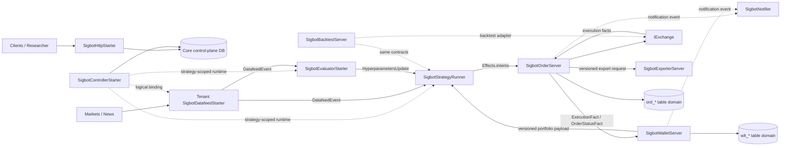

# SigBot Core Architecture

[中文](overview_CN.md) · [Documentation index](../index.md)

**Status:** Current architecture and implementation boundary. The alignment
table records the remaining evidence gaps; it no longer describes superseded
pre-runtime-v2 scaffolding.

SigBot is an AI-assisted quantitative trading system, not a general-purpose
workflow or DAG platform. Its central design is a constrained, typed Workflow:
a non-deterministic AI side path classifies the current
market structure and recommends bounded hyperparameters, while deterministic
Python strategy code combines that recommendation with market data and the
current portfolio state to make the final trading decision.

The AI never places orders. When the market cannot be classified, confidence
is too low, an evaluation has expired, or a required input is inconsistent,
the deterministic boundary emits no opening intent.

## System Model



The platform plane consists of API, Controller, and Web. HTTP and A2A APIs
own CRUD for tenant bindings, Workflows, worker connections, and related
configuration; Controller owns startup, update, shutdown, and health recovery
for the nine tenant components. Authguard remains the sole owner of users,
memberships, roles, and permissions.

The data plane consists of Backtest, Datafeed, Evaluator, Strategy, Logger,
Exporter, Notifier, Order, and Wallet. Controller dynamically deploys these nine
components with tenant/Workflow resource isolation; they asynchronously pub/sub
the different Workflow node types. A long-running tenant-shared Workflow uses
the same topology without weakening tenant/Workflow topic and state boundaries.

## Decision Contract

The live decision path joins three versioned inputs:

1. `DatafeedEvent` and its bounded market window, normalized by Datafeed.
2. The latest non-expired `HyperparametersUpdate` whose evaluated watermark
   does not look beyond the decision event.
3. A current versioned portfolio payload owned by Wallet.

`HyperparametersUpdate` contains at least the market regime
(`trend`, `range`, `stabilizing`, `suppression`, or `unknown`) probabilities,
schema-validated hyperparameter overrides or weights, input watermark, model
and prompt provenance, effective time, and expiry. The evaluator may be
non-deterministic; the snapshot is immutable and auditable.

`SigbotStrategyRunner` validates the snapshot against the strategy's declared
parameter schema and assembles one immutable execution context. For the same
market window, evaluation snapshot, portfolio version, strategy version, and
risk policy, Python strategy execution must produce the same `Effects`.
`UNKNOWN`, stale or invalid inputs produce no opening intent. Only validated
trade intents cross the Order boundary through MQTT.

## Constrained Workflow

```text
Workflow feed route
  -> Evaluator side path -----------+
  -> Strategy Runner <--------------+ EvaluationSnapshot
       ^
       +------------------------------ PortfolioSnapshot
       -> Order Manager -> Exchange
              -> Wallet Manager
              -> Exporter
              -> Notifier (typed operational events only)
```

Workflow graphs are configurable but not arbitrary code graphs. Nodes are
limited to the nine registered component modules, and edges must resolve to an
allowed v2 topic or a validated module-routing default. The graph can disable
optional capabilities and contain multiple typed nodes, but it cannot introduce
an unknown node kind, bypass Order/Wallet, or create a direct AI-to-Exchange edge.

## Core Services

| Service         | Runtime scope             | Canonical responsibility                                                           | Design                                            |
| --------------- | ------------------------- | ---------------------------------------------------------------------------------- | ------------------------------------------------- |
| API             | Platform service          | Exposes HTTP and A2A CRUD for tenant bindings, Workflows, workers, and connections | [APIServer](platform/api/api.md)                  |
| Controller      | Platform service          | Manages nine tenant data-plane components on remote Docker/Kubernetes workers      | [Controller](platform/controller/controller.md)   |
| Web             | Platform service          | Configures and observes tenant Workflows through Authguard-protected APIs          | [APIServer](platform/api/api.md)                  |
| Datafeed        | Tenant/Workflow component | Normalizes market/news data and publishes event/availability-time records          | [Datafeed](component/datafeed/datafeed.md)        |
| Evaluator       | Tenant/Workflow component | Classifies market structure and publishes bounded versioned snapshots              | [Evaluator](component/evaluator/evaluator.md)     |
| Strategy Runner | Tenant/Workflow component | Deterministically joins feed, evaluation, and portfolio inputs                     | [Strategy Runner](component/strategy/strategy.md) |
| Order           | Tenant/Workflow component | Owns checks, reservations, venue submission, reconciliation, and order facts       | [Order](component/order/order.md)                 |
| Wallet          | Tenant/Workflow component | Owns reservations, immutable ledger, balances, positions, and portfolio snapshots  | [Wallet](component/wallet/wallet.md)              |
| Backtest        | Tenant/Workflow component | Reuses the decision contracts with virtual time and simulated exchange             | [Backtest](component/backtest/backtest.md)        |
| Notifier        | Tenant/Workflow component | Idempotently delivers Email, Telegram, and in-product notifications                | [Notifier](component/notifier/notifier.md)        |
| Exporter        | Tenant/Workflow component | Cursor-based, batched export with retries and backpressure                         | [Exporter](component/exporter/exporter.md)        |
| Logger          | Tenant/Workflow component | Durably buffers and archives Python/Rust logs outside the decision path            | [Logger](component/logger/logger.md)              |

Tenant, user, identity, membership, role, permission, policy, and logical
namespace semantics have one canonical owner:
[Tenant Governance & IAM](platform/api/api.md#iam).

## Embedded Components and Protocol Adapters

These components are composed into services; they are not independently
deployed Workflow nodes.

| Component | Responsibility                                                                                                                            | Design                                            |
| --------- | ----------------------------------------------------------------------------------------------------------------------------------------- | ------------------------------------------------- |
| Exchange  | Unified async trading, account, market-data, and stream capabilities for venues such as Binance, IBKR, Polymarket, and the Backtest venue | [Exchange](component/order/order.md#exchange-sdk) |
| Messager  | Transport-neutral async event SDK: local queue in all-in-one mode and MQTT/EMQX in distributed mode                                       | [Messager](messager/messager.md)                  |
| A2A       | Optional external agent interoperability; it cannot bypass pipeline policy or place orders directly                                       | [A2A](platform/api/a2a.md)                        |
| MCP       | API exposure generated independently by mcpfather from HTTP OpenAPI; external-source clients remain separate                              | [MCP](platform/api/api.md#mcp)                    |

## Naming and Extension Rules

- Public service roots and startup types use a domain-specific `Sigbot...`
  name; the exact exported symbol is listed below.
- Existing replaceable ports use concise `I<Capability>` names. New ports
  follow the owning module's established convention instead of inventing a
  parallel naming scheme.
- Concrete adapters carry their provider and capability in a stable name.
- `Provider` denotes a factory-selected implementation family. Current delivery
  media use `NotificationProviderConfig`; export destinations use
  `ExportSinkConfig`.
- Rust acronyms use PascalCase words: `Api`, `Http`, `Mqtt`, `Qq`, `Ibkr`.
- Interfaces belong at actual variation boundaries; avoid a one-to-one trait
  that only mirrors a startup shell.

| Module          | Service root              | Primary extension ports                                                                                  |
| --------------- | ------------------------- | -------------------------------------------------------------------------------------------------------- |
| APIServer       | `SigbotHttpStarter`       | Core handlers and repositories exposed through HTTP/A2A adapters; external MCP is generated by mcpfather |
| Controller      | `SigbotControllerStarter` | `WorkerProvider`                                                                                         |
| Datafeed        | `SigbotDatafeedIngestor`  | `IDatafeed`                                                                                              |
| Backtest        | `SigbotBacktestServer`    | `ReplaySource`, `ReplayDecision`, `IExchange`                                                            |
| Evaluator       | `SigbotEvaluatorRunner`   | `IEvaluator`                                                                                             |
| Strategy Runner | `SigbotStrategyRunner`    | `IStrategy`                                                                                              |
| Order           | `SigbotOrderServer`       | `IOrder`, execution adapters                                                                             |
| Wallet          | `SigbotWalletServer`      | `IWallet`                                                                                                |
| Notifier        | `SigbotNotifier`          | `INotifier`, `NotificationProviderConfig`                                                                |
| Exporter        | `SigbotExporterServer`    | `IExporter`, `ExportSinkConfig`                                                                          |
| Exchange SDK    | Composed, no daemon       | `IExchange`, capability-specific subports                                                                |
| Messager SDK    | Composed, no daemon       | `IMessager`                                                                                              |

## Data Ownership and Consistency

- API is the only writer for user-driven control-plane configuration. The
  independent Controller reads immutable Workflow/Worker configuration and is
  the only writer for run claims, selected workers, attempts, and observed
  lifecycle state. Both use the same Core handlers/repositories; data-plane
  components do not read control-plane configuration tables directly.
- Order and Wallet have separate prefixed table domains and exclusive Repository
  write ownership. The current final-state migration places both domains in one
  physical PostgreSQL schema; sharing a schema does not permit cross-domain SQL
  or a second writer.
- Order persists order/execution facts and a transactional outbox atomically.
  Wallet applies each monetary execution fact through an inbox and updates its
  ledger, balance, position, and outbox in one local transaction.
- Cross-service state is recoverable eventual consistency with idempotency,
  replay, and exchange reconciliation. An external venue cannot participate in
  a PostgreSQL transaction.
- If order and portfolio state truly require one ACID transaction, they must be
  one physical bounded-context service. Two daemons sharing tables is not a
  strong-consistency design.
- Specialized market-history, tenant middleware, and object storage remain
  private to their owning component even when an operator co-locates physical
  database infrastructure.

## Messaging Invariants

- A published topic never contains MQTT's `$share` prefix. `$share` is a
  subscription filter concern.
- Evaluator and Strategy Runner use different consumer groups for the same
  feed. Replicas of one component share a group; different component roles do
  not, otherwise they would divide events instead of each receiving them.
- Business-event ownership follows the producer: Datafeed owns feed events,
  Evaluator owns evaluation snapshots, Strategy Runner owns trade intents, Order owns
  execution facts, and Wallet owns portfolio snapshots. Messager owns only the
  envelope and delivery semantics.
- Every envelope carries event ID, tenant ID, Workflow ID, producer, schema
  version, event time, publication time, `run_id`, seq, and attempt_no. No
  separate correlation ID is permitted.
- W3C `traceparent` carries trace context. For asynchronous requests,
  `requestSpanId` equals the producer span_id and is echoed by the response; it
  is short-lived QoS pairing state and is never persisted.
- Consumers assume duplicate and delayed delivery, establish an idempotency
  boundary, and define ordering/partition keys explicitly.
- MQTT/EMQX plus PostgreSQL Inbox/Outbox is the durable distributed runtime.
  Local transport is a single-process compatibility adapter and must not be
  presented as equivalent recovery or persistent fan-out.

## Global Safety Invariants

- AI output is advisory, bounded by a strategy-declared schema, versioned, and
  auditable. It cannot call private exchange operations.
- Strategy Runner cannot call an exchange. Order Manager is the only service
  allowed to invoke private trading capabilities and must repeat hard risk and
  account checks.
- A placement acknowledgement is not a fill. Wallet changes money and position
  only from authoritative fill, settlement, fee, funding, transfer, or
  liquidation facts.
- No component reads another component's private tables.
- Credentials and private keys stay within their owning security boundary and
  never appear in events, logs, or unredacted responses.
- Backtests prevent look-ahead: an evaluation or portfolio snapshot may only be
  used after its original publication/effective time.

<a id="provider-lifecycle"></a>

## Source boundaries and Provider lifecycle

The nine directories under `component/` correspond exactly to the starters in
`src/cmd/src/startup/component/`: `backtest`, `datafeed`, `evaluator`, `exporter`,
`logger`, `notifier`, `order`, `strategy`, and `wallet`. Strategy's domain root is
`src/component/strategy/runner/`; the other eight use `src/component/<module>/`.

| Source                                   | Owner and dependency boundary                                                    |
| ---------------------------------------- | -------------------------------------------------------------------------------- |
| `src/api/{http,a2a}/`                    | Protocol, authentication, DTO conversion and routing; calls Core handlers        |
| `src/controller/`                        | Independent scheduler and remote Docker/Kubernetes adapters; calls Core handlers |
| `src/component/`                         | Nine dynamic tenant components; calls Core handlers and embedded SDKs            |
| `src/core/src/modules/<domain>/handler/` | Public use cases and transaction orchestration                                   |
| `src/core/src/modules/<domain>/storage/` | Private repositories, SQL and transaction implementation                         |
| `src/common/context/`                    | Shared `ApplicationContext` and `IProvider` lifecycle                            |
| `src/types/src/<domain>/`                | Flat cross-crate contracts, with no intermediate `modules/` layer                |
| `src/core/src/config/`                   | Single typed configuration entry point                                           |
| `src/cmd/src/startup/`                   | API, Controller, component and optional standalone process composition           |

Every domain contract inherits `IProvider`. All application modules obtain the
same process-level `ApplicationContext::global()`; accessing it neither starts
the context nor replaces it after shutdown. The entry point registers async
constructors, calls `init()`, and eventually awaits `shutdown()`. Registration
is keyed by domain interface type and `instance_id`, with lazy first-use
initialization and shared instances for identical keys. Deliberately isolated
tests use `ApplicationContext::new()`.

`register_with::<Target, Source>` projects multiple interfaces from one object
without duplicating its lifecycle. Initialization failures clean up partially
started resources. Shutdown stops intake and waits for active work before
closing providers; higher shutdown phases close dependents before messaging
and storage, with reverse cleanup where ordered ownership requires it.
`close_for` can close one instance. Signal hooks and normal process return use
the same idempotent shutdown path.

Every starter holds `SigbotManagementStarter`; `startup/internal/management.rs`
owns panic setup, context initialization, telemetry, private management
listeners, readiness and cleanup. Disabling the listener retains base
initialization and signal handling. Domain functions belong to concrete type
implementations. `lib.rs`/`mod.rs` declare modules and exports; `server.rs`
composes the service. No duplicate registry, singleton or factory owns a second
lifecycle.

Components and adapters call public handlers, never Core's private repositories,
SQL, pools or transactions. `sigbot-messager -> sigbot-core -> sigbot-types` is
one-way; Core does not depend on MQTT clients, Messager or its reply cache.
Generic repositories expose `select`, `select_by`, `insert`, `update`, `upsert`
and `delete_by_id`; atomic sequencing, fact consistency, locking and
Inbox/Outbox operations retain their domain-specific transaction semantics.
PostgreSQL and SQLite implement the same contracts. Production files stay
within 800 effective lines, Core handlers within 500 and domain repositories
within 250; tests mirror their owning source under each crate's `tests/`.

## Configuration, scope and execution mode

Business modules import and call `get_config()`. Precedence is defaults < YAML
< `SIGBOT__...` environment overrides. Scalar `${VARIABLE:default}` expansion
does not invoke a shell; duplicate/unknown keys, old aliases and noncanonical
enum values fail. Only central configuration and general runtime tooling read
the environment. Components resolve stable Secret-map keys through
`get_config().secrets.require()`; credentials never enter Worker metadata or
workflow snapshots. Full startup, mounted YAML and provider selection are
described in [Build and test](../development/build-and-test.md#starting-a-module-from-yaml).

`env + tenant_id + workflow_id + node_id + run_id` isolates data-plane work.
`scope.env` selects deployment/routing environments such as dev/sit/uat/prod;
`ExecutionMode::{Live, Paper, Backtest}` independently selects trading behavior.
Workflow save, Run snapshot, WorkerPlan, Order, Wallet and replay validate the
same mode. Live uses a real execution adapter and reconciles unknown outcomes
under the original order identity. Paper uses an explicit simulator/demo
adapter. Backtest uses frozen history, virtual time and deterministic matching.
Changing a production exchange URL is never a mode switch.

<a id="runtime-storage"></a>

## Runtime storage and recovery

The ten public configuration domains are defined by the [API contract](platform/api/api.md#domain-contracts).
Internal tables remain separate wherever they enforce runtime recovery,
idempotency or accounting; they cannot be collapsed into configuration JSON.

| Domain                 | Tables                                                                                                                     | Sole writer through Core                                               |
| ---------------------- | -------------------------------------------------------------------------------------------------------------------------- | ---------------------------------------------------------------------- |
| Business configuration | `tenant_info`, `cluster_info`, `datasource_info`, `exchange_info`, `strategy_info`, `notifier_info`, `exporter_info`       | ResourceHandler / generic repository                                   |
| Workflow and run       | `workflow_info`, `wf_run`, `wf_checkpoint`, `wf_sequence`, `wf_timer`                                                      | Workflow repository; Controller owns run/worker lifecycle              |
| Messaging              | `msg_inbox`, `msg_outbox`                                                                                                  | Messager repository participating in domain transactions               |
| Market data            | `mkt_event`, `mkt_delivery`                                                                                                | Datafeed repository                                                    |
| Evaluation memory      | `eval_case`, `eval_snapshot`                                                                                               | Evaluator repository                                                   |
| Replay                 | `bt_checkpoint`, `bt_order`                                                                                                | Backtest repository                                                    |
| Orders                 | `order_info`, `ord_execution`, `ord_execution_group`, `ord_execution_leg`, `ord_venue_checkpoint`, `ord_venue_observation` | Order repository                                                       |
| Wallet                 | `ledger_info`, `wlt_ledger`, `wlt_journal`, `wlt_posting`, `wlt_reservation`, `wlt_balance`, `wlt_position`                | Wallet repository                                                      |
| Logs                   | `log_chunk`                                                                                                                | Logger repository; payloads in immutable S3/MinIO chunks               |
| Notifications          | `notifier_info`, `ntf_delivery`                                                                                            | Resource configuration and Notifier delivery transactions respectively |
| Exports                | `exp_checkpoint`                                                                                                           | Exporter repository                                                    |

Entity IDs and dependent foreign keys are UUIDv7. Ordered coordinates such as
`node_id`, `seq`, `revision`, `line_no` and venue-native identifiers retain their
own types. `workflow_info` and `wf_run` bind through
`(env, tenant_id, workflow_id)`; checkpoints, timers, deliveries, evaluations,
logs and notifications retain that scope. `ledger_info` binds each account
uniquely by `(env, tenant_id, account_id)`, and Order references its wallet in
the same scope, without string casts or cross-tenant joins.

`wlt_ledger`, `wlt_journal`, `wlt_posting` and `ord_venue_observation` are
immutable. Corrections append facts or reversing entries. Posting balance is
checked per asset at commit; balances, positions and portfolio versions are
rebuildable projections. The unused `wlt_equity_snapshot`, legacy `ntf_read`
and their dead code have been removed; analytical equity remains a derived
view rather than a claim that those tables still exist.

Inbox/Outbox deduplicate by scope, owner, node, run and sequence; persistent JSON
excludes `requestSpanId`. Market facts require `event_at <= available_at`, and
evaluation output requires `as_of <= available_at`. Detailed transaction and
recovery rules belong to [Messager](messager/messager.md) and the owning
component documents.

There is one final-state baseline:

```text
migration/20261031000000/
├── postgres/{init.ddl.sql,init.dml.sql}
└── sqlite/{init.ddl.sql,init.dml.sql}
```

The migration runner serializes PostgreSQL with an advisory transaction lock
and SQLite with `BEGIN IMMEDIATE`, recording the combined SHA-256 in
`mig_version`. Applied-file drift aborts. This baseline targets empty databases;
an existing database with an older checksum needs a separate upgrade/import
plan. It performs no implicit online DROP/ALTER or old-format compatibility.
Schema owners apply migrations; application accounts have DML only, no schema,
trigger or superuser privileges. See [migration procedures](../development/build-and-test.md#database-migrations).
PostgreSQL is the distributed acceptance baseline; SQLite serves local
single-process development. Control-plane PostgreSQL may include TimescaleDB
and pgvector, while tenant data-plane instances are separately declared on
scoped `cluster_info` and never share write responsibility implicitly.

<a id="deployment-contracts"></a>

## Deployment and bootstrap contracts

Helm has one `global/sigbot/middleware/secrets` values tree, with domain templates under `api/controller/web/platform/middleware/gateway/observability`. ConfigMaps and Secrets are separate, and Deployments carry configuration checksums. The middleware wrapper forwards values to the vendored official Authguard 1.0.2 chart; Helm owns Chart.lock. Authguard defaults to enabled and owns independent IAM PostgreSQL/Redis credentials and bootstrap. Sigbot control-plane storage is separate from IAM and tenant data-plane storage. Its PostgreSQL image includes TimescaleDB and pgvector; extension initialization applies to newly created databases.

`setup-secret.sh` and its Kubernetes/AWS/GCP/Vault peers validate one canonical payload from `sigbot-secrets.env.example`, then synchronize the target Secret; failure aborts installation. The same PostgreSQL/Redis credential values feed middleware startup and typed central configuration, with only references in values. Runtime Secret rotation increments `secrets.revision`. Platform workloads run the baseline migration initContainer before startup, while Controller uses each cluster record's provider instead of a global Docker/Kubernetes switch.

One Grafana template generates Controller plus nine component dashboards. ServiceMonitor and sidecar discovery are explicit switches; dynamic Pods expose private management and scrape annotations. Deployment commands belong to the [deployment runbook](../runbooks/deployment.md), and actual execution evidence to the [development handover](../development/handover.md#acceptance).

## Implementation Alignment

| Area                  | Implemented boundary                                                                                                                                                                          | Remaining evidence or product gap                                                                                                          |
| --------------------- | --------------------------------------------------------------------------------------------------------------------------------------------------------------------------------------------- | ------------------------------------------------------------------------------------------------------------------------------------------ |
| API and IAM           | HTTP CRUD plus MCP/A2A outlets use explicit Authguard request identity and Core PostgreSQL/SQLite repositories                                                                                | Real Hosted Login, production domains/TLS, and an authenticated browser save/start/trace flow still need external credentials              |
| Controller            | Independently reconciles nine component kinds and typed Redis/pgvector/TimescaleDB/EMQX resources on Docker or Kubernetes                                                                     | The latest four-middleware reconciler has manifest/compile tests but has not completed a fresh end-to-end real-cluster lifecycle run       |
| Datafeed              | REST/MCP/A2A social ingestion, policy RSS, persisted history, LATEST/AS_OF snapshots, and Binance/Hyperliquid public market reads exist                                                       | Full liquidation heatmaps, lending/funding/position-ratio coverage and additional venues remain incomplete                                 |
| Evaluator             | Consumes feed events, calls the bounded LLM path, separates facts/inference, stores cases, and publishes versioned five-state snapshots                                                       | Real-model quality/calibration and production pgvector memory quality have not been accepted                                               |
| Strategy Runner       | Transactional state drafts, serial callbacks, typed Effects, market/compute/service results, sandboxing, checkpoints, and intent-only trading output are implemented                          | Redis hot caching and general distributed incremental/model sharding are not implemented                                                   |
| Order and Wallet      | Reservation-first ordering, hard risk, prepared submissions, unknown-result reconciliation, immutable executions, balanced ledger/projections, and transactional Inbox/Outbox are implemented | Real-money venue settlement, long-running reconciliation, corporate actions/margin, and genuine cross-venue compensation remain unaccepted |
| Backtest              | Frozen history, virtual time, replay barriers, deterministic matching/fees, resting limit orders, and isolated replay are implemented                                                         | Depth queues, realistic partial liquidity/latency, and all model-shard equivalence are outside the current simulator                       |
| Notifier and Exporter | In-app/Email/Telegram delivery state and Kafka/Google Sheets sinks have typed requests, checkpoints, retries, and idempotency boundaries                                                      | Real SMTP/Telegram/Sheets credentials and Kafka multi-broker failover have not been accepted                                               |
| Logger                | SQLite WAL durable ACK, immutable conditional S3 chunks, hash verification, PostgreSQL cursors, and Python/Rust capture are implemented                                                       | Host-volume loss, production bucket retention/replication, and capture from every Rust host remain open                                    |
| Messager              | MQTT QoS 1 persistent sessions, manual ACK, scoped topics, Inbox/Outbox, replay, backpressure, and temporary reply pairing are implemented                                                    | Broker-disk disaster and sustained-load tests remain open; Local transport is intentionally not durability-equivalent                      |

The component documents own their detailed contracts and capability status.
The coding-agent handoff records the exact verification baseline and next work:
[development handover](../development/handover.md).
