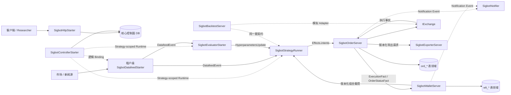

# SigBot Core 架构

[English](overview.md) · [文档索引](../index_ZH.md)

**状态：** 当前架构与实现边界。实现对齐表记录尚缺的证据和产品能力，不再描述已淘汰的
runtime-v2 之前骨架。

SigBot 是 AI 辅助量化交易系统，不是通用 Workflow 或 DAG 平台。其核心是受约束、
类型化的 Workflow：非确定性的 AI 旁路判断当前市场结构并推荐受限超参数；确定性
Python 策略代码把该建议与行情、当前组合状态一起计算，产生最终交易决策。

AI 永远不直接下单。市场无法判断、置信度过低、评估已过期或必要输入不一致时，
确定性边界必须返回空的开仓 Intent，不能新开仓位。

## 系统模型



平台面核心服务是 API、Controller 与 Web：HTTP/A2A API 负责租户绑定、Workflow、Worker
连接等配置的 CRUD；Controller 负责租户级九个组件的启动、更新、停止与健康恢复。
认证、用户、权限和成员关系统一由 Authguard 管理，Sigbot 不复制平台 IAM 表。

数据面核心是 Backtest、Datafeed、Evaluator、Strategy、Logger、Exporter、Notifier、
Order、Wallet 九个租户级组件。它们由 Controller 按 tenant/workflow 隔离动态部署，分别
通过 MQTT 异步 pub/sub 执行 Workflow 中不同类型的节点；同一架构也允许为某个租户部署
一套长期运行的 shared Workflow，但 Topic 与持久状态仍保持 tenant/workflow 边界。

## 决策契约

实时决策链路 Join 三类带版本输入：

1. Datafeed 规范化的 `DatafeedEvent` 及其有界行情窗口。
2. 最新且未过期、评估水位不超过本次决策事件的 `HyperparametersUpdate`。
3. Wallet 拥有的当前版本化组合载荷。

`HyperparametersUpdate` 至少包含市场形态（`trend`、`range`、
`stabilizing`、`suppression`、`unknown`）概率、通过 Schema
校验的超参数 Override 或权重、输入水位、Model/Prompt 来源、生效时间与过期时间。
Evaluator 可以非确定，但 Snapshot 必须不可变、可审计。

`SigbotStrategyRunner` 按策略声明的参数 Schema 校验 Snapshot，并组装一次不可变
执行上下文。对于相同的行情窗口、Evaluation Snapshot、Portfolio Version、
Strategy Version 和 Risk Policy，Python 策略必须产生相同的 `Effects`。`UNKNOWN`、
过期或非法输入不得产生开仓 Intent；只有通过校验的交易 Intent 才能经 MQTT 跨越
Order 边界。

## 受约束的 Workflow

```text
Workflow feed route
  -> Evaluator 旁路 ----------------+
  -> Strategy Runner <--------------+ EvaluationSnapshot
       ^
       +------------------------------ PortfolioSnapshot
       -> Order Manager -> Exchange
              -> Wallet Manager
              -> Exporter
              -> Notifier（仅接收类型化运维事件）
```

Workflow 图可配置，但不是任意代码图。Node 只能选择九种已注册组件，Edge 必须解析为
允许的 v2 topic 或通过校验的默认模块路由。图可以关闭可选能力、包含多个类型化节点，
但不能引入未知 Node、绕过 Order/Wallet，或建立 AI 直连 Exchange 的边。

## 核心服务

| 服务 | 运行作用域 | 规范职责 | 设计 |
|---|---|---|---|
| API | 平台共享服务 | 暴露 HTTP、A2A，负责租户业务绑定、Workflow、Worker 和连接配置 CRUD | [APIServer](engine/apiserver/overview_ZH.md) |
| Controller | 平台共享服务 | 为远程 Docker/Kubernetes Worker 调度并管理九个租户数据面组件生命周期 | [Controller](engine/controller/overview_ZH.md) |
| Web | 平台共享服务 | 以 Authguard 身份访问 API，配置和观察租户 Workflow | [APIServer](engine/apiserver/overview_ZH.md) |
| Datafeed | 租户/Workflow 动态组件 | 规范化行情与新闻，发布带事件/可得时间的数据 | [Datafeed](engine/datafeed/overview_ZH.md) |
| Evaluator | 租户/Workflow 动态组件 | 识别市场结构并发布受限、带版本的 Evaluation Snapshot | [Evaluator](engine/evaluator/overview_ZH.md) |
| Strategy Runner | 租户/Workflow 动态组件 | 确定性 Join Feed、Evaluation 和 Portfolio，产生交易意图 | [Strategy Runner](engine/strategy-runner/overview_ZH.md) |
| Order | 租户/Workflow 动态组件 | 拥有预检、预占、下单、对账及订单/成交事实 | [Order](engine/order-manager/overview_ZH.md) |
| Wallet | 租户/Workflow 动态组件 | 拥有预占、不可变 Ledger、Balance、Position 和 Portfolio Snapshot | [Wallet](engine/wallet-manager/overview_ZH.md) |
| Backtest | 租户/Workflow 动态组件 | 使用虚拟时钟和模拟交易所复用相同决策契约 | [Backtest](engine/backtest/overview_ZH.md) |
| Notifier | 租户/Workflow 动态组件 | 幂等投递 Email、Telegram 与站内通知 | [Notifier](engine/notifier/overview_ZH.md) |
| Exporter | 租户/Workflow 动态组件 | 以游标、批量和背压导出 Kafka、Google Sheets 等目标 | [Exporter](engine/exporter/overview_ZH.md) |
| Logger | 租户/Workflow 动态组件 | 持久缓冲并归档 Python/Rust 日志，不参与交易决策 | [Logger](engine/logger/overview_ZH.md) |

Tenant、User、Identity、Membership、Role、Permission、Policy 与逻辑 Namespace
只有一个规范归属：[Tenant Governance & IAM](engine/apiserver/tenant-governance-and-iam_ZH.md)。

## 内嵌组件与协议 Adapter

这些组件由服务组合，不作为独立部署的 Workflow Node。

| 组件 | 职责 | 设计 |
|---|---|---|
| Exchange | 统一异步交易、账户、市场数据与 Stream 能力，当前目录覆盖 Binance、Hyperliquid、IBKR、Polymarket、Kalshi、Paper 与 Backtest | [Exchange](engine/exchange/overview_ZH.md) |
| Messager | 与传输无关的异步事件 SDK：All-in-one 模式使用 Local Queue，分布式模式使用 MQTT/EMQX | [Messager](engine/messager/overview_ZH.md) |
| A2A | 可选的外部 Agent 互操作协议；不能绕过 Pipeline Policy 或直接下单 | [A2A](engine/a2a/overview_ZH.md) |
| MCP | 由 mcpfather 从 HTTP OpenAPI 独立生成的 API 暴露方式；外部源 MCP 客户端单独保留 | [MCP](engine/mcp/overview_ZH.md) |

## 命名与扩展规则

- 公开 Service Root 和启动类型使用领域明确的 `Sigbot...` 名称，准确导出符号见下表。
- 已有可替换 Port 使用简洁的 `I<Capability>`；新增 Port 沿用所属模块约定，禁止另造平行命名体系。
- 具体 Adapter 的稳定名称应体现 Provider 与 Capability。
- `Provider` 表示由 Factory 选择的实现族。当前投递媒介使用
  `NotificationProviderConfig`，导出目标使用 `ExportSinkConfig`。
- Rust 缩写按 PascalCase 单词书写：`Api`、`Http`、`Mqtt`、`Qq`、`Ibkr`。
- 接口只建立在真实变化点，禁止创建只与启动壳一一镜像的空 Trait。

| 模块 | Service Root | 主要扩展 Port |
|---|---|---|
| APIServer | `SigbotHttpStarter` | 通过 HTTP/A2A Adapter 暴露 Core Handler/Repository；MCP 由 mcpfather 独立生成 |
| Controller | `SigbotControllerStarter` | `WorkerProvider` |
| Datafeed | `SigbotDatafeedIngestor` | `IDatafeed` |
| Backtest | `SigbotBacktestServer` | `ReplaySource`、`ReplayDecision`、`IExchange` |
| Evaluator | `SigbotEvaluatorRunner` | `IEvaluator` |
| Strategy Runner | `SigbotStrategyRunner` | `IStrategy` |
| Order | `SigbotOrderServer` | `IOrder`、Execution Adapter |
| Wallet | `SigbotWalletServer` | `IWallet` |
| Notifier | `SigbotNotifier` | `INotifier`、`NotificationProviderConfig` |
| Exporter | `SigbotExporterServer` | `IExporter`、`ExportSinkConfig` |
| Exchange SDK | 内嵌，无 daemon | `IExchange` 及按能力拆分的子 Port |
| Messager SDK | 内嵌，无 daemon | `IMessager` |

## 数据所有权与一致性

- API 是用户驱动的控制面配置唯一写入方。独立 Controller 读取不可变 Workflow/Worker
  配置，并独占写 Run Claim、选定 Worker、Attempt 和观测生命周期状态。两者共用 Core
  Handler/Repository；数据面组件不直接读取控制面配置表。
- Order 与 Wallet 各有独立前缀的表领域和唯一 Repository 写所有权。当前最终态迁移
  把两域放在同一个物理 PostgreSQL Schema；共享 Schema 不允许跨域 SQL 或第二写入方。
- Order 在一个事务内原子保存订单/执行事实与 Transactional Outbox。Wallet 通过
  Inbox 应用每个资金事实，并在一个本地事务内更新 Ledger、Balance、Position 与
  Outbox。
- 跨服务使用可恢复的最终一致性、幂等、重放与 Exchange 对账。外部 Venue 无法参与
  PostgreSQL Transaction。
- 如果 Order 与 Portfolio 确实必须处于同一 ACID 事务，它们就必须合并为一个物理
  Bounded-context Service；两个 daemon 共享表不属于强一致设计。
- 专用行情历史、租户中间件和对象存储仍由所属组件私有拥有，即使运维上共置物理
  数据库基础设施也不能改变写所有权。

## 消息不变量

- 发布 Topic 永远不包含 MQTT `$share` 前缀；`$share` 只属于 Subscription Filter。
- Evaluator 与 Strategy Runner 对同一 Feed 使用不同 Consumer Group。同一组件的
  Replica 共用一个 Group；不同角色禁止共组，否则双方会瓜分消息而不是各收一份。
- 业务事件由 Producer 拥有：Datafeed 拥有 Feed Event，Evaluator 拥有 Evaluation
  Snapshot，Strategy Runner 拥有 Trade Intent，Order 拥有 Execution Fact，Wallet 拥有
  Portfolio Snapshot。Messager 只拥有 Envelope 与投递语义。
- 每个 Envelope 携带 Event ID、Tenant ID、Workflow ID、Producer、Schema Version、
  Event Time、Publish Time、`run_id`、seq 与 attempt_no；禁止另建 correlation ID。
- Trace 使用 W3C `traceparent`；异步请求的 `requestSpanId` 等于 producer span_id，响应原样回显，
  只作短期 QoS 配对且不得持久化。
- Consumer 必须假定重复和延迟投递，建立幂等边界并显式定义 Ordering/Partition Key。
- MQTT/EMQX + PostgreSQL Inbox/Outbox 是分布式持久运行路径。Local 只是单进程兼容
  Adapter，不能宣称具备等价恢复或持久 Fan-out。

## 全局安全不变量

- AI 输出只能作为受 Strategy-declared Schema 约束、带版本且可审计的建议，不能
  调用 Exchange 私有交易能力。
- Strategy Runner 禁止调用 Exchange。Order Manager 是唯一允许调用私有交易能力
  的服务，并且必须重复执行硬风险与账户校验。
- Placement Acknowledgement 不是 Fill。Wallet 只能根据权威 Fill、Settlement、Fee、
  Funding、Transfer 或 Liquidation Fact 改变资金和仓位。
- 任何组件都不能读取其他组件的私有表。
- Credential 与 Private Key 留在所属安全边界内，禁止出现在事件、日志或未脱敏响应。
- Backtest 禁止未来函数：Evaluation 或 Portfolio Snapshot 只能在原始发布/生效时间
  之后使用。

## 实现对齐

| 范畴 | 已实现边界 | 尚缺证据或产品能力 |
|---|---|---|
| API 与 IAM | HTTP CRUD、MCP/A2A 出口使用显式 Authguard Request Identity 和 Core PostgreSQL/SQLite Repository | 真实 Hosted Login、生产域名/TLS，以及登录浏览器保存/启动/Trace 全链仍需外部凭据 |
| Controller | 独立协调九类组件及 Docker/Kubernetes 上强类型 Redis/pgvector/TimescaleDB/EMQX | 最新四中间件 Reconciler 已有 Manifest/编译测试，但尚未完成一次新的真实集群全生命周期复验 |
| Datafeed | 已有 REST/MCP/A2A 社交摄取、政策 RSS、持久历史、LATEST/AS_OF 快照与 Binance/Hyperliquid 公共行情 | 完整清算热力图、借贷/资金费率/持仓比和更多交易所仍未完成 |
| Evaluator | 已消费 Feed、调用有界 LLM、分离事实/推断、保存案例并发布版本化五态 Snapshot | 真实模型质量/校准与生产 pgvector 记忆质量未验收 |
| Strategy Runner | 已实现事务 State 草稿、串行回调、类型化 Effects、查询/服务结果、沙箱、Checkpoint 与只发布 Signal | Redis 热缓存、通用分布式增量/模型分片未实现 |
| Order 与 Wallet | 已实现预占先行、硬风控、Prepared Submission、未知结果对账、不可变执行、平衡账本/投影和事务 Inbox/Outbox | 实盘结算、长期对账、公司行动/保证金和真实跨所补偿未验收 |
| Backtest | 已实现冻结历史、虚拟时钟、回放屏障、确定性撮合/费用、挂单与隔离回放 | 深度队列、真实部分流动性/延迟及全部模型分片等价不在当前模拟器范围 |
| Notifier 与 Exporter | 站内/Email/Telegram 状态及 Kafka/Google Sheets Sink 已有类型化请求、Checkpoint、重试和幂等边界 | 真实 SMTP/Telegram/Sheets 凭据与 Kafka 多 Broker 故障切换未验收 |
| Logger | 已实现 SQLite WAL 持久 ACK、S3 条件创建不可变分块、哈希校验、PG Cursor 和 Python/Rust 采集 | 宿主卷损毁、生产桶保留/多副本及所有 Rust 宿主采集仍待完成 |
| Messager | 已实现 MQTT QoS1 持久会话、手动 ACK、作用域 Topic、Inbox/Outbox、补放、背压和临时响应配对 | Broker 磁盘灾难与持续压力测试仍缺；Local 明确不具备持久等价性 |

各组件文档拥有详细契约和能力状态。精确验证基线与下一步工作见 Coding Agent 交接文档：
[`docs/development/HARDCOVER.md`](../development/HARDCOVER.md)。
