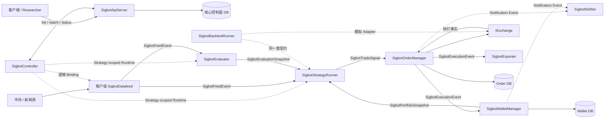

# SigBot Core 架构

[English](overview.md) · [文档索引](../index_ZH.md)

**状态：** 规范性目标架构。实现对齐表明确区分当前已有行为与必须满足的设计契约。

SigBot 是 AI 辅助量化交易系统，不是通用 Workflow 或 DAG 平台。其核心是受约束的
`StrategyPipeline`：非确定性的 AI 旁路判断当前市场结构并推荐受限超参数；确定性
Python 策略代码把该建议与行情、当前组合状态一起计算，产生最终交易决策。

AI 永远不直接下单。市场无法判断、置信度过低、评估已过期或必要输入不一致时，
确定性边界必须产生 `NONE`，不开新仓。

## 系统模型



平台面核心服务是 API、Controller 与 Web：三种 API 负责租户绑定、Workflow、Worker
连接等配置的 CRUD；Controller 负责租户级九个组件的启动、更新、停止与健康恢复。
认证、用户、权限和成员关系统一由 Authguard 管理，Sigbot 不复制平台 IAM 表。

数据面核心是 Backtest、Datafeed、Evaluator、Strategy、Logservice、Exporter、Notifier、
Order、Wallet 九个租户级组件。它们由 Controller 按 tenant/workflow 隔离动态部署，分别
通过 MQTT 异步 pub/sub 执行 Workflow 中不同类型的节点；同一架构也允许为某个租户部署
一套长期运行的 shared Workflow，但 Topic 与持久状态仍保持 tenant/workflow 边界。

## 决策契约

实时决策链路 Join 三类带版本输入：

1. Datafeed 规范化的 `SigbotFeedEvent` 及其有界行情窗口。
2. 最新且未过期、评估水位不超过本次决策事件的 `SigbotEvaluationSnapshot`。
3. Wallet Manager 拥有的当前 `SigbotPortfolioSnapshot`。

`SigbotEvaluationSnapshot` 至少包含市场形态（`RANGING`、
`TRENDING_BULLISH`、`TRENDING_BEARISH` 或 `UNKNOWN`）、置信度、通过 Schema
校验的超参数 Override 或权重、输入水位、Model/Prompt 来源、生效时间与过期时间。
Evaluator 可以非确定，但 Snapshot 必须不可变、可审计。

`SigbotStrategyRunner` 按策略声明的参数 Schema 校验 Snapshot，并组装一次不可变
执行上下文。对于相同的行情窗口、Evaluation Snapshot、Portfolio Version、
Strategy Version 和 Risk Policy，Python 策略必须产生相同的
`SigbotTradeSignal`。`UNKNOWN`、过期或非法输入默认得到 `NONE`。只有可执行信号
才能跨越 Order Manager 边界。

## 固定 Strategy Pipeline

```text
DatafeedBinding
  -> Evaluator 旁路 ----------------+
  -> Strategy Runner <--------------+ EvaluationSnapshot
       ^
       +------------------------------ PortfolioSnapshot
       -> Order Manager -> Exchange
              -> Wallet Manager
              -> Exporter
              -> Notifier（仅接收类型化运维事件）
```

`StrategyPipeline` 是固定产品资源，不是任意图。其 Spec 包含 Feed Binding、
Evaluator 配置、确定性 Strategy 配置、执行账户与 Venue、Risk Policy、通知渠道、
导出目标和 Desired State。可选能力可以关闭，但调用方不能创建新 Node 类型或任意
Edge。

## 核心服务

| 服务 | 运行作用域 | 规范职责 | 设计 |
|---|---|---|---|
| API | 平台共享服务 | 暴露 HTTP、MCP、A2A，负责租户业务绑定、Workflow、Worker 和连接配置 CRUD | [APIServer](engine/apiserver/overview_ZH.md) |
| Controller | 平台共享服务 | 为远程 Docker/Kubernetes Worker 调度并管理九个租户数据面组件生命周期 | [Controller](engine/controller/overview_ZH.md) |
| Web | 平台共享服务 | 以 Authguard 身份访问 API，配置和观察租户 Workflow | [APIServer](engine/apiserver/overview_ZH.md) |
| Datafeed | 租户/Workflow 动态组件 | 规范化行情与新闻，发布带事件/可得时间的数据 | [Datafeed](engine/datafeed/overview_ZH.md) |
| Evaluator | 租户/Workflow 动态组件 | 识别市场结构并发布受限、带版本的 Evaluation Snapshot | [Evaluator](engine/evaluator/overview_ZH.md) |
| Strategy Runner | 租户/Workflow 动态组件 | 确定性 Join Feed、Evaluation 和 Portfolio，产生交易意图 | [Strategy Runner](engine/strategy-runner/overview_ZH.md) |
| Order | 租户/Workflow 动态组件 | 拥有预检、预占、下单、对账及订单/成交事实 | [Order](engine/order-manager/overview_ZH.md) |
| Wallet | 租户/Workflow 动态组件 | 拥有预占、不可变 Ledger、Balance、Position 和 Portfolio Snapshot | [Wallet](engine/wallet-manager/overview_ZH.md) |
| Backtest | 租户/Workflow 动态组件 | 使用虚拟时钟和模拟交易所复用相同决策契约 | [Backtest](engine/backtest/overview_ZH.md) |
| Notifier | 租户/Workflow 动态组件 | 幂等投递 Email、Telegram 与站内通知 | [Notifier](engine/notifier/overview_ZH.md) |
| Exporter | 租户/Workflow 动态组件 | 以游标、批量和背压导出 Kafka、Google Sheets 等目标 | [Exporter](engine/exporter/overview_ZH.md) |
| Logservice | 租户/Workflow 动态组件 | 持久缓冲并归档 Python/Rust 日志，不参与交易决策 | [Logservice](engine/log-service/overview_ZH.md) |

Tenant、User、Identity、Membership、Role、Permission、Policy 与逻辑 Namespace
只有一个规范归属：[Tenant Governance & IAM](engine/apiserver/tenant-governance-and-iam_ZH.md)。

## 内嵌组件与协议 Adapter

这些组件由服务组合，不独占固定交易 Pipeline 的一个步骤。

| 组件 | 职责 | 设计 |
|---|---|---|
| Exchange | 统一异步交易、账户、市场数据与 Stream 能力，适配 Binance、Bitget、Coinbase、IBKR、Schwab 及模拟 Venue 等 | [Exchange](engine/exchange/overview_ZH.md) |
| Messager | 与传输无关的异步事件 SDK：All-in-one 模式使用 Local Queue，分布式模式使用 MQTT/EMQX | [Messager](engine/messager/overview_ZH.md) |
| A2A | 可选的外部 Agent 互操作协议；不能绕过 Pipeline Policy 或直接下单 | [A2A](engine/a2a/overview_ZH.md) |
| MCP | 可选的 API 暴露和 Evaluator 辅助上下文工具协议；不是规范实时行情源 | [MCP](engine/mcp/overview_ZH.md) |

## 命名与扩展规则

- 公开 Service Root 和启动类型使用 `Sigbot<Component>`。
- 可替换 Port 使用 `ISigbot<Capability>`。
- 具体 Adapter 使用 `Sigbot<Provider><Capability>`。
- `Provider` 表示由 Factory 选择的实现族。投递媒介叫 `NotificationChannel`，
  导出目标叫 `ExportSink`。
- Rust 缩写按 PascalCase 单词书写：`Api`、`Http`、`Mqtt`、`Qq`、`Ibkr`。
- 接口只建立在真实变化点，禁止创建只与启动壳一一镜像的空 Trait。

| 模块 | Service Root | 主要扩展 Port |
|---|---|---|
| APIServer | `SigbotApiServer` | `ISigbotApiTransport`、`ISigbotCoreRepository` |
| Controller | `SigbotController` | `ISigbotPipelineController`、`ISigbotRuntimeProvider` |
| Datafeed | `SigbotDatafeed` | `ISigbotDatafeedSource` |
| Backtest | `SigbotBacktestRunner` | `ISigbotBacktestEngine`、`ISigbotClock` |
| Evaluator | `SigbotEvaluator` | `ISigbotMarketEvaluator` |
| Strategy Runner | `SigbotStrategyRunner` | `IStrategy` |
| Order Manager | `SigbotOrderManager` | `IOrder`、`ISigbotRiskPolicy` |
| Wallet Manager | `SigbotWalletManager` | `IWallet`、`ISigbotPortfolioLedger` |
| Notifier | `SigbotNotifier` | `ISigbotNotifier`、`ISigbotNotificationChannel` |
| Exporter | `SigbotExporter` | `ISigbotExporter`、`ISigbotExportSink` |
| Exchange SDK | 内嵌，无 daemon | `IExchange` 及按能力拆分的子 Port |
| Messager SDK | 内嵌，无 daemon | `IMessager` |

## 数据所有权与一致性

- APIServer 是核心控制面数据库的唯一 Client。Controller、Evaluator、Strategy
  Runner 等 Engine 只使用 APIServer API、Watch、Configuration Snapshot 或事件。
- Order Manager 独占写 Order Database/Schema；Wallet Manager 独占写 Wallet
  Database/Schema。两者可以为降低运维成本共用物理 PostgreSQL Cluster，但禁止
  共用凭据、表或写所有权。
- Order 在一个事务内原子保存订单/执行事实与 Transactional Outbox。Wallet 通过
  Inbox 应用每个资金事实，并在一个本地事务内更新 Ledger、Balance、Position 与
  Outbox。
- 跨服务使用可恢复的最终一致性、幂等、重放与 Exchange 对账。外部 Venue 无法参与
  PostgreSQL Transaction。
- 如果 Order 与 Portfolio 确实必须处于同一 ACID 事务，它们就必须合并为一个物理
  Bounded-context Service；两个 daemon 共享表不属于强一致设计。
- 专用行情历史库和可观测性存储不是核心控制面数据库，仍由所属组件私有拥有。

## 消息不变量

- 发布 Topic 永远不包含 MQTT `$share` 前缀；`$share` 只属于 Subscription Filter。
- Evaluator 与 Strategy Runner 对同一 Feed 使用不同 Consumer Group。同一组件的
  Replica 共用一个 Group；不同角色禁止共组，否则双方会瓜分消息而不是各收一份。
- 业务事件由 Producer 拥有：Datafeed 拥有 Feed Event，Evaluator 拥有 Evaluation
  Snapshot，Strategy Runner 拥有 Signal，Order 拥有 Execution Fact，Wallet 拥有
  Portfolio Snapshot。Messager 只拥有 Envelope 与投递语义。
- 每个 Envelope 携带 Event ID、Tenant ID、Workflow ID、Producer、Schema Version、
  Event Time、Publish Time、`run_id`、seq 与 attempt_no；禁止另建 correlation ID。
- Trace 使用 W3C `traceparent`；异步请求的 `requestSpanId` 等于 producer span_id，响应原样回显，
  只作短期 QoS 配对且不得持久化。
- Consumer 必须假定重复和延迟投递，建立幂等边界并显式定义 Ordering/Partition Key。
- Local 与 MQTT 实现必须提供等价的可观测 Fan-out、Cancellation、Backpressure 和
  Failure 语义。

## 全局安全不变量

- AI 输出只能作为受 Strategy-declared Schema 约束、带版本且可审计的建议，不能
  调用 Exchange 私有交易能力。
- Strategy Runner 禁止调用 Exchange。Order Manager 是唯一允许调用私有交易能力
  的服务，并且必须重复执行硬风险与账户校验。
- Placement Acknowledgement 不是 Fill。Wallet 只能根据权威 Fill、Settlement、Fee、
  Funding、Transfer 或 Liquidation Fact 改变资金和仓位。
- 任何组件都不能读取其他组件的私有表。
- Credential 与 Private Key 留在所属安全边界内，禁止出现在事件、日志或未脱敏响应。
- Backtest 禁止未来函数：Evaluation 或 Portfolio Snapshot 只能在原始发布/生效时间
  之后使用。

## 实现对齐

| 范畴 | 当前证据 | 必须对齐的契约 |
|---|---|---|
| APIServer 与核心 DB | APIServer 已有 Core Repository；Evaluator、Strategy、Controller 等路径仍会构造 `SigbotState` | 由 APIServer 独占控制面 DB，并提供 List/Watch/Status 契约 |
| Controller | `src/controller/` 仍通过扫描数据库协调 Tenant-scoped 资源 | 按 `SigbotController` 语义，仅通过 APIServer Reconcile Strategy Pipeline |
| Datafeed | 已有 Provider 骨架和发布代码 | 增加规范 Envelope、Source 复用、逻辑 Binding 与正确 Topic 展开 |
| Evaluator | 已有 Multi-agent Executor；事件驱动行情订阅不完整 | 发布包含 Regime、Confidence、Watermark 和 Expiry 的类型化、版本化 Snapshot |
| Strategy Runner | 已有 Python 执行；当前路径未 Join Evaluation/Portfolio，且存在直连 Exchange 路径 | 强制三输入确定性执行，只向 Order Manager 发布 Signal |
| Order Manager | 已有 Signal 订阅骨架 | 增加持久化 Order/Fill 状态、Exchange 注册、硬风险、幂等、对账与 Outbox |
| Wallet Manager | 已有 PostgreSQL Updater | 使用专用 Store，并在一个事务内更新 Inbox、Ledger、Balance 与 Position Effect |
| Backtest | 可部署的运行组件 | 组合 Historical Replay、Virtual Clock、Backtest Exchange 与隔离 Run State |
| Notifier 与 Exporter | 已有 Email/Telegram 与 Google Sheets/Kafka 骨架 | 增加类型化路由、真实 Adapter、幂等、重试、Receipt 及保留 Channel/Sink |
| Messager | 已有 Local 与 MQTT Client | 增加显式 Consumer Group 与等价的多订阅/Fan-out 语义 |

各组件文档拥有详细契约和能力状态。只有源码与测试共同提供证据时才能宣称能力已
实现；尚未完成的目标要求仍然是规范性设计。
